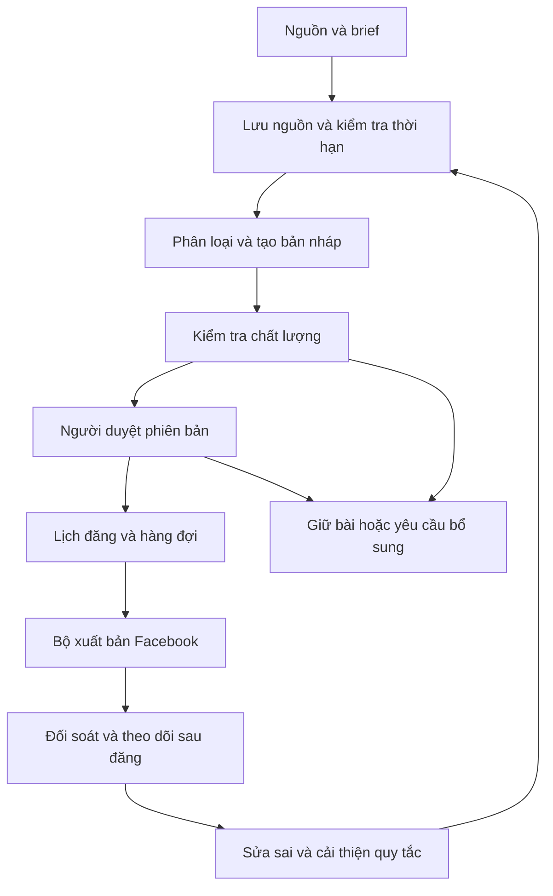

# AI FACEBOOK AUTO POSTER
## Bản thảo ý tưởng, yêu cầu sản phẩm và thiết kế vận hành — Draft v1

| Thuộc tính | Giá trị |
| --- | --- |
| Phiên bản | Draft v1.0 |
| Ngày lập | 30/10/2026 |
| Mục đích | Lưu trữ cá nhân, thảo luận với người phụ trách và làm nền tảng xây dựng prototype/MVP |
| Trạng thái | Đề xuất để rà soát; chưa phải đặc tả triển khai đã được phê duyệt |
| Đối tượng ban đầu | Một Fanpage phục vụ cộng đồng địa phương |
| Chế độ MVP | AI hỗ trợ tạo bài; người quản trị duyệt trước khi đăng |

> Tài liệu tổng hợp ý tưởng gốc và bổ sung các khoảng trống về chất lượng thông tin, vận hành, bảo mật, thương mại và xử lý sự cố. Các ngưỡng, tỷ lệ và lựa chọn triển khai chưa có dữ liệu thực tế đều là đề xuất cần kiểm chứng. Khả năng tích hợp và chính sách Facebook phải được đối chiếu với tài liệu Meta và thử nghiệm tại thời điểm triển khai.

## Mục lục

1. Bài toán và mục tiêu
2. Nguyên tắc thiết kế
3. Vai trò và trách nhiệm
4. Phạm vi MVP và định hướng mở rộng
5. Chế độ vận hành và phân loại rủi ro
6. Kiến trúc khái niệm
7. Quản lý đầu vào và nguồn tin
8. Tạo nội dung và hình ảnh
9. Kiểm duyệt và phê duyệt
10. Luồng nghiệp vụ và trạng thái
11. Xuất bản, lịch đăng và xử lý lỗi
12. Vận hành sau đăng và đính chính
13. Bảo mật và quản lý dữ liệu
14. Thương mại hóa và quản trị biên tập
15. Đo lường, chi phí và tính khả thi
16. Danh mục rủi ro
17. Lộ trình và điều kiện chuyển giai đoạn
18. Tiêu chí nghiệm thu MVP
19. Các quyết định còn mở
20. Phụ lục biểu mẫu và tài liệu tham chiếu

## 1. Bài toán và mục tiêu

### 1.1. Bài toán

Người vận hành trang địa phương phải tìm nguồn, viết lại thông tin, chuẩn bị ảnh, kiểm tra độ chính xác, đăng bài và xử lý phản hồi. Công việc lặp lại tiêu tốn thời gian, trong khi sai sót có thể ảnh hưởng đến uy tín của trang và người dân.

Hệ thống hỗ trợ người quản trị thực hiện các bước này theo một quy trình có thể theo dõi. Mức tự động hóa tăng dần dựa trên kết quả thực tế, không mặc định giao toàn bộ quyền xuất bản cho AI.

### 1.2. Mục tiêu kép

**Giai đoạn cộng đồng:** cung cấp thông tin địa phương hữu ích, có căn cứ, dễ hiểu; xây dựng uy tín và giảm thời gian sản xuất nội dung.

**Giai đoạn thương mại:** nhận bài tài trợ hoặc giới thiệu doanh nghiệp phù hợp để trang trải chi phí và có thể tái đầu tư cho hoạt động cộng đồng. Việc chuyển giai đoạn phụ thuộc cả chất lượng vận hành, nhu cầu khách hàng và khả năng tài chính.

### 1.3. Kết quả mong đợi

- Giảm tổng thời gian làm một bài, bao gồm cả thời gian kiểm tra và sửa lỗi.
- Truy được nguồn, phiên bản được duyệt, người duyệt và kết quả xuất bản.
- Có thể giữ bài, hủy bài và dừng lịch đăng khi chưa đủ điều kiện.
- Đo được giá trị cho người đọc và chi phí vận hành thực tế.
- Xây được quy trình xử lý sai sót sau đăng.

### 1.4. Những điều không cam kết

Hệ thống không bảo đảm tăng reach, tăng follower, tránh mọi hạn chế từ Facebook hoặc bảo đảm nội dung AI luôn đúng. Việc dùng thêm một AI kiểm tra cũng không được xem là xác minh độc lập nguồn tin.

## 2. Nguyên tắc thiết kế

1. **Độ tin cậy trước số lượng:** không đủ nguồn hoặc chưa được duyệt thì giữ bài.
2. **Có người chịu trách nhiệm:** từng loại nội dung phải có người quyết định cuối cùng.
3. **Duyệt đúng phiên bản:** thay đổi nội dung, ảnh, link hoặc đích đăng sau duyệt phải được xem xét lại.
4. **Tự động hóa theo rủi ro:** phân loại theo hậu quả nếu sai, bên cạnh phân loại cộng đồng/thương mại.
5. **Tuân theo khả năng nền tảng:** dùng phương thức tích hợp được hỗ trợ; không thiết kế dựa trên giả định “giả lập người dùng sẽ tránh bị phát hiện”.
6. **Có thể dừng và khôi phục:** mọi tác vụ quan trọng có trạng thái, lịch sử và đường xử lý lỗi.
7. **Tách dữ liệu khỏi lệnh:** tài liệu nguồn và brief không được tự thay đổi quy tắc hoặc quyền của bot.
8. **Đơn giản ở MVP:** một trang, ít nguồn, một kênh duyệt chính, giới hạn loại bài.
9. **Linh hoạt công nghệ có giới hạn:** tách bộ tạo nội dung khỏi bộ xuất bản, nhưng chưa xây hạ tầng nhiều nhà cung cấp khi chưa có nhu cầu.

## 3. Vai trò và trách nhiệm

| Vai trò | Trách nhiệm | Quyền chính |
| --- | --- | --- |
| Chủ dự án | Định hướng, ngân sách, chính sách biên tập và thương mại | Phê duyệt chính sách, quyết định sự cố lớn |
| Người biên tập | Nhập nguồn, tạo và sửa bản thảo | Tạo/sửa, gửi duyệt; không tự đổi quyền hệ thống |
| Người duyệt | Kiểm tra nguồn, ảnh, lịch và nội dung | Duyệt, từ chối, yêu cầu bổ sung |
| Người vận hành | Theo dõi hàng đợi, lỗi kết nối, kết quả đăng | Dừng lịch, xử lý tác vụ lỗi theo quyền |
| Người phụ trách phản hồi | Theo dõi phản ánh và đề xuất sửa sai | Chuyển sự cố, đề nghị sửa/gỡ |
| Hệ thống AI | Tạo bản nháp, trích xuất và gắn cờ | Không tự cấp quyền hoặc bỏ qua bước duyệt |

MVP có thể do một người kiêm nhiều vai trò nhưng vẫn ghi nhận người thực hiện và hành động. Nội dung rủi ro cao chỉ mở khi có người đủ khả năng phụ trách. Xác định người thay thế khi người duyệt vắng mặt; nếu chưa có thì bài tiếp tục chờ.

## 4. Phạm vi MVP và định hướng mở rộng

### 4.1. Trong MVP

- Quản lý một Fanpage được chỉ định.
- Người quản trị nhập văn bản nguồn hoặc nguồn đã chọn; hệ thống lưu căn cứ tương ứng.
- Cấu hình giọng văn, thông tin địa phương và các quy tắc cơ bản.
- AI tạo bản nháp, đề xuất tiêu đề và đánh dấu chi tiết cần kiểm tra.
- Dùng ảnh do người quản trị cung cấp có thông tin nguồn/quyền sử dụng.
- Duyệt qua một giao diện chính; kênh thông báo chỉ hỗ trợ nhắc việc.
- Đăng ngay hoặc đặt lịch sau duyệt.
- Lưu lịch sử phiên bản, kết quả đăng và cảnh báo lỗi.
- Dừng lịch đăng, sửa/gỡ theo khả năng tích hợp đã xác minh; có phương án thao tác trực tiếp khi cần.
- Theo dõi thời gian làm bài, công sửa và chi phí cơ bản.

### 4.2. Chưa triển khai trong MVP

- Tự động đăng vào Group hoặc hồ sơ cá nhân.
- Thu thập tin tự động diện rộng.
- Tự đăng tin khẩn, tai nạn, cáo buộc, quyên góp hoặc thông tin nhạy cảm.
- Tự trả lời bình luận/inbox, tự chốt đơn hoặc xử lý thanh toán.
- Tự động sinh ảnh hiện trường, tự tối ưu theo tương tác hoặc quản lý nhiều trang.
- Quản lý hợp đồng quảng cáo, phân bổ tiền tái đầu tư và báo cáo ROI đầy đủ.

### 4.3. Mở rộng có điều kiện

Ảnh AI, bình luận đầu tiên, bài tài trợ, thu thập nguồn tự động và chế độ tự đăng chỉ được bổ sung sau khi chứng minh được nhu cầu, khả năng nền tảng và quy trình kiểm soát tương ứng.

## 5. Chế độ vận hành và phân loại rủi ro

### 5.1. Chế độ

| Chế độ | Hành vi | Phạm vi |
| --- | --- | --- |
| Hỗ trợ thủ công | AI tạo nháp; người dùng tự đăng và ghi nhận kết quả | Dùng thử hoặc phương án dự phòng |
| Bán tự động | Người duyệt đúng phiên bản; hệ thống đăng ngay/đặt lịch | Mặc định MVP |
| Tự động có điều kiện | Chỉ tự đăng danh mục được cho phép, khi đủ điều kiện | Sau MVP |

Không có người duyệt không đồng nghĩa với được phép tự đăng. Chế độ hỗ trợ thủ công không thể bảo đảm chống đăng trùng ngoài hệ thống; cần ghi nhận đường dẫn và đối soát trước khi chuyển lại sang đăng bằng bot.

### 5.2. Phân loại hai trục

Mỗi bài có loại nội dung: **cộng đồng, thương mại hoặc kết hợp**; đồng thời có mức rủi ro riêng.

| Mức | Ví dụ | Quy trình đề xuất |
| --- | --- | --- |
| Thấp | Giới thiệu văn hóa, nội dung thường xanh đã xác minh | Người duyệt trong MVP; có thể đánh giá tự đăng sau |
| Trung bình | Lịch sự kiện, thông báo dịch vụ, chương trình ưu đãi | Kiểm tra ngày giờ, nguồn và thời hạn; bắt buộc duyệt |
| Cao | Thiên tai, tai nạn, cáo buộc, dữ liệu cá nhân, quyên góp | Giữ ngoài luồng MVP; người phụ trách kiểm tra và xử lý riêng |

Loại sản phẩm, khẳng định quảng cáo và nhóm người bị ảnh hưởng có thể làm tăng mức rủi ro. Người duyệt được tăng mức hoặc giữ bài; việc hạ mức phải có lý do được lưu lại.

### 5.3. Điều kiện tự đăng trong tương lai

Danh mục được cho phép, nguồn còn hiệu lực, không có cờ cần kiểm tra, không trùng bài, chưa vượt hạn mức, tài khoản đích hợp lệ và hệ thống không đang tạm dừng. Bất kỳ điều kiện nào không đạt đều chuyển về chờ duyệt. Chế độ này cần nghiệm thu riêng trước khi bật.

## 6. Kiến trúc khái niệm



### 6.1. Các thành phần

- **Kho nguồn:** căn cứ, thời gian lấy tin, hiệu lực và quyền sử dụng.
- **Kho ngữ cảnh:** địa danh, từ điển địa phương, cách xưng hô, thông tin thương hiệu; mỗi mục có người cập nhật và ngày rà soát.
- **Bộ điều phối:** phân loại nội dung, mức rủi ro và chế độ cho phép.
- **Bộ tạo nội dung:** sinh bản thảo theo dữ liệu được cấp.
- **Bộ kiểm tra:** đối chiếu dữ kiện, kiểm tra thiếu nguồn, thời hạn, link và nội dung trùng.
- **Giao diện duyệt:** hiển thị bản xem trước và căn cứ, lưu quyết định theo phiên bản.
- **Bộ lịch và hàng đợi:** quản lý thời điểm, hạn mức và trạng thái.
- **Bộ xuất bản:** giữ thông tin xác thực ở phía máy chủ, thực hiện các thao tác nền tảng đã được nghiệm thu.
- **Nhật ký và giám sát:** ghi lịch sử, cảnh báo lỗi và chi phí.

### 6.2. Dữ liệu tối thiểu

| Thực thể | Trường quan trọng |
| --- | --- |
| Nguồn | ID, URL/tài liệu, người cung cấp, ngày nguồn, ngày lấy, nội dung làm căn cứ, ngày diễn ra, hạn hiệu lực |
| Bài viết | ID, loại, mức rủi ro, trang đích, trạng thái, người phụ trách |
| Phiên bản | ID phiên bản, nội dung, ảnh, link, danh sách nguồn, dấu thời gian, cấu hình/model tạo nháp |
| Phê duyệt | Phiên bản, người duyệt, thời điểm, quyết định, ghi chú, lịch/đích đã duyệt |
| Tác vụ đăng | ID, phiên bản, thời điểm, khóa chống trùng, số lần thử, kết quả, mã bài Facebook |
| Sự cố | Loại, mức độ, người xử lý, hành động, kết quả và thời điểm kết thúc |
| Số liệu | Bài, thời điểm lấy, định nghĩa chỉ số, giá trị hoặc trạng thái không lấy được |

## 7. Quản lý đầu vào và nguồn tin

### 7.1. Quy tắc nguồn

- Ưu tiên nguồn trực tiếp, có người/tổ chức chịu trách nhiệm.
- Lưu đủ nội dung làm căn cứ theo quyền sử dụng cho phép, thay vì chỉ giữ URL có thể thay đổi.
- Tách trạng thái “đã có nguồn”, “đã kiểm tra” và “còn hiệu lực”.
- Nhiều bài sao chép cùng một tin không được xem là nhiều xác nhận độc lập.
- Thông tin từ khách hàng là khẳng định cần kiểm tra; không mặc định đúng vì đã trả phí.
- Nếu nguồn mâu thuẫn hoặc thiếu dữ kiện quan trọng, giữ bài để người phụ trách xử lý.

### 7.2. Kiểm tra trước tạo và trước đăng

Kiểm tra ngày/tháng/năm, địa điểm, đơn vị tổ chức, phạm vi áp dụng và cập nhật mới. Bài có thời hạn phải có mốc hết hiệu lực. Bài duyệt quá lâu cần kiểm tra lại theo loại nội dung; thời gian cụ thể do người phụ trách cấu hình.

MVP ưu tiên nguồn do người quản trị đưa vào. Việc tự lấy tin, quyền truy cập và quyền sử dụng lại nội dung là hạng mục cần đánh giá riêng trước mở rộng.

## 8. Tạo nội dung và hình ảnh

### 8.1. Quy tắc viết

- Không thêm tên, số liệu, trích dẫn, trải nghiệm cá nhân hoặc chi tiết hiện trường không có trong nguồn.
- Không tự suy đoán phần thiếu; trả về danh sách câu hỏi cần bổ sung.
- Giữ nguyên ý nghĩa, phạm vi và mức độ chắc chắn của nguồn.
- Dùng từ địa phương khi phù hợp; không giả vờ là người chứng kiến.
- Không ép mọi bài theo Hook–Body–CTA. Tin thông báo ưu tiên thông tin thiết yếu; nội dung khẩn ưu tiên hướng dẫn rõ ràng.
- Bài thương mại phải kiểm tra giá, thời hạn, điều kiện áp dụng, số liên hệ và các khẳng định về sản phẩm.

Đầu ra gồm bản nháp, nguồn đã dùng, chi tiết cần kiểm tra và gợi ý ảnh. Điểm tự tin của AI, nếu có, chỉ là tín hiệu hỗ trợ; không thay thế bằng chứng.

### 8.2. Quy tắc hình ảnh

- MVP ưu tiên ảnh đã xác định nguồn và quyền sử dụng.
- Không dùng ảnh AI để tạo cảm giác đó là ảnh hiện trường thật.
- Nếu dùng ảnh minh họa có khả năng gây hiểu nhầm, cần nhận diện rõ là ảnh minh họa.
- Kiểm tra khuôn mặt, địa danh, logo, chữ, giá và số điện thoại trong ảnh.
- Việc ghi nguồn không mặc nhiên cấp quyền sử dụng.
- Ảnh là một phần của phiên bản được duyệt; thay ảnh phải duyệt lại.

## 9. Kiểm duyệt và phê duyệt

### 9.1. Kiểm tra tự động

Hệ thống đối chiếu dữ kiện với nguồn, cảnh báo nội dung không được hỗ trợ, ngày hết hạn, nguồn mâu thuẫn, dữ liệu cá nhân, link sai, bài trùng và các khẳng định nhạy cảm. Bộ lọc từ khóa chỉ là một lớp hỗ trợ vì ngữ cảnh có thể làm thay đổi ý nghĩa.

### 9.2. Màn hình duyệt

Hiển thị bản xem trước chữ/ảnh/link; nguồn; các chi tiết cần kiểm tra; loại và mức rủi ro; trang đích; thời điểm đăng; thông tin tài trợ nếu có. Người duyệt có thể duyệt, từ chối, sửa hoặc yêu cầu bổ sung và xem khác biệt giữa các phiên bản.

### 9.3. Ràng buộc

- Phê duyệt gắn với phiên bản nội dung, nguồn làm căn cứ, trang đích và lịch đăng.
- Đổi nội dung/ảnh/link/trang đích hoặc đổi lịch thủ công làm mất hiệu lực duyệt và cần xác nhận lại.
- Khi nguồn hoặc hạn hiệu lực thay đổi, bài phải được rà soát lại.
- Bài chờ quá hạn không được tự đăng; thông báo và giữ/hủy theo cấu hình.
- Bản xem trước chỉ mang tính gần đúng nếu Facebook hiển thị khác; các thành phần quan trọng phải được kiểm tra trong thử nghiệm tích hợp.

## 10. Luồng nghiệp vụ và trạng thái

### 10.1. Luồng chuẩn

1. Người biên tập tạo yêu cầu, chỉ định nguồn, loại bài và trang đích.
2. Hệ thống kiểm tra nguồn, thời hạn và điều kiện đầu vào.
3. AI tạo bản nháp; bộ kiểm tra trả về cảnh báo.
4. Người biên tập sửa và gửi duyệt.
5. Người duyệt kiểm tra đúng phiên bản cùng nguồn, ảnh và lịch.
6. Trước xuất bản, hệ thống kiểm tra lại hiệu lực duyệt, hạn bài, trạng thái dừng và khả năng kết nối.
7. Bộ xuất bản gửi bài; lưu kết quả và mã bài nếu thành công.
8. Đối soát kết quả; theo dõi phản ánh và số liệu.

### 10.2. Trạng thái nghiệp vụ

| Trạng thái | Ý nghĩa và hành động tiếp theo |
| --- | --- |
| Nháp | Có thể sửa hoặc tạo lại |
| Cần bổ sung | Thiếu nguồn/dữ kiện; chưa thể duyệt |
| Chờ duyệt | Người duyệt xem phiên bản cụ thể |
| Bị từ chối | Có lý do; sửa sẽ tạo phiên bản mới |
| Đã duyệt | Đủ điều kiện vào lịch/hàng đợi |
| Đã lên lịch | Chờ kiểm tra trước đăng |
| Đang đăng | Tác vụ đã bắt đầu; ngăn tác vụ khác đăng cùng yêu cầu |
| Chưa xác định kết quả | Có khả năng đã đăng; cần đối soát trước thử lại |
| Đăng thất bại | Lỗi đã xác định; xử lý theo loại lỗi |
| Đã đăng | Có căn cứ xác nhận kết quả và đường dẫn/mã bài |
| Hết hạn hoặc đã hủy | Không được tiếp tục đăng |
| Cần đính chính | Bài đã đăng có phản ánh cần xử lý |
| Đã sửa hoặc gỡ | Lưu lịch sử và căn cứ hành động |

Sửa/gỡ là một quy trình có phê duyệt và tác vụ riêng; thất bại khi sửa/gỡ phải có cảnh báo. Tạm dừng toàn hệ thống là trạng thái vận hành, không tự xóa hoặc đánh dấu hủy mọi bài.

## 11. Xuất bản, lịch đăng và xử lý lỗi

### 11.1. Xác minh khả năng nền tảng trước triển khai

Thử nghiệm trên đúng tài khoản/trang dự kiến dùng: đăng chữ, ảnh, lấy mã bài, bình luận, sửa/gỡ và lấy các chỉ số cần thiết. Ghi rõ phương thức tích hợp, phiên bản API, quyền cần có, điều kiện xét duyệt nếu áp dụng, lỗi và giới hạn quan sát được.

Fanpage, Group và hồ sơ cá nhân phải được đánh giá riêng. Chưa xác minh thì không đưa vào cam kết sản phẩm. Nếu tích hợp chưa đáp ứng, có thể dùng chế độ tạo nháp và đăng thủ công.

### 11.2. Lịch đăng

- Mặc định sử dụng múi giờ Asia/Ho_Chi_Minh và hiển thị rõ cho người duyệt.
- Cấu hình hạn mức ngày, khoảng cách tối thiểu và giờ được phép đăng.
- Không đăng dồn toàn bộ bài trễ sau khi hệ thống hoạt động trở lại; kiểm tra lại từng bài.
- Không thêm trễ ngẫu nhiên cho thông báo cần đúng giờ. Nếu tương lai cho phép khoảng giờ linh hoạt thì người duyệt phải biết khoảng đó.
- Chọn giờ đăng dựa trên nhu cầu và thử nghiệm; không cam kết trễ ngẫu nhiên giúp tránh giảm reach.

### 11.3. Chống đăng trùng và thử lại

Mỗi yêu cầu/phiên bản/trang đích có khóa nội bộ để ngăn tác vụ trùng và lưu lịch sử thử. Khóa nội bộ không bảo đảm Facebook chỉ nhận đúng một lần khi kết nối bị gián đoạn.

Nếu gửi yêu cầu nhưng không nhận kết quả, chuyển sang “chưa xác định kết quả”. Đối soát bằng khả năng nền tảng hỗ trợ; nếu không xác định chắc chắn, yêu cầu người vận hành kiểm tra thay vì tự gửi lại. Lỗi tạm thời chỉ thử lại có giới hạn; lỗi quyền hoặc xác thực phải cảnh báo và dừng tác vụ liên quan.

### 11.4. Bình luận phụ trợ

Đây là hạng mục sau MVP, chỉ mở sau thử nghiệm quyền thực tế. Tác vụ bình luận tách khỏi tác vụ bài chính. Bình luận thất bại không làm đăng lại bài chính. Nguồn, điều kiện ưu đãi hoặc thông tin thiết yếu không được phụ thuộc hoàn toàn vào bình luận.

### 11.5. Dừng khẩn cấp

Nút dừng ngăn tác vụ mới bắt đầu, hiển thị tác vụ đang chạy và không hứa có thể hủy yêu cầu đã gửi. Sau khi dừng, đối soát các bài có thể đã đăng. Chỉ tiếp tục khi người có quyền xác nhận.

## 12. Vận hành sau đăng và đính chính

### 12.1. Theo dõi

Chỉ định người nhận phản ánh và khung giờ theo dõi thực tế. MVP có thể kiểm tra bình luận trực tiếp trên Facebook; không mặc định đã có khả năng thu thập tự động. Ngoài giờ trực, không tự đăng những loại bài cần phản ứng nhanh.

### 12.2. Khi có phản ánh sai thông tin

1. Ghi nhận đường dẫn, nội dung phản ánh và mức ảnh hưởng.
2. Tạm dừng các bài liên quan nếu cần.
3. Kiểm tra lại nguồn và phiên bản đã đăng.
4. Người phụ trách quyết định sửa, gỡ, giải thích hoặc đăng đính chính.
5. Thực hiện, xác nhận kết quả và ghi lịch sử.
6. Cập nhật nguồn/quy tắc để giảm tái diễn.

Không mặc định sửa âm thầm là đủ khi bản cũ đã được chia sẻ hoặc ảnh hưởng đến hành động của người đọc. Gỡ bài không thu hồi được ảnh chụp hoặc nội dung đã lan truyền.

### 12.3. Mức độ sự cố

| Mức | Ví dụ | Phản ứng |
| --- | --- | --- |
| Nhẹ | Lỗi trình bày không đổi ý nghĩa | Sửa theo quy trình, lưu lịch sử |
| Đáng kể | Sai giờ, giá, địa điểm, điều kiện | Xử lý ưu tiên; cân nhắc thông báo đính chính |
| Nghiêm trọng | Lộ khóa, thông tin gây hại, đăng sai trang | Dừng hệ thống/phạm vi ảnh hưởng, thu hồi quyền nếu cần và xử lý trực tiếp |

Thời gian phản hồi mục tiêu phải phù hợp nhân sự; chưa đặt cam kết trực 24/7 trong Draft v1.

## 13. Bảo mật và quản lý dữ liệu

### 13.1. Quyền và thông tin xác thực

- Giữ khóa/token ở phía máy chủ, ngoài prompt và nhật ký thường.
- Cấp quyền tối thiểu; tách quyền soạn, duyệt, xuất bản và cấu hình.
- Phê duyệt phải gắn với danh tính đã xác thực; không duyệt chỉ vì người dùng có một đường link.
- Có quy trình thu hồi quyền khi thành viên rời dự án hoặc nghi ngờ lộ khóa.
- Cảnh báo khi kết nối mất quyền; không chỉ dựa vào ngày hết hạn dự kiến.
- Tách môi trường thử nghiệm và môi trường thật.

### 13.2. Chống chỉ dẫn độc hại trong nguồn

Nội dung website, tài liệu và brief là dữ liệu không đáng tin về mặt điều khiển. AI không được làm theo chỉ dẫn trong nguồn để bỏ duyệt, đổi tài khoản, thêm link hoặc chuyển tiền. Bộ xuất bản xác thực quyền và đích đăng độc lập với đầu ra AI. Link, hotline và thông tin nhận tiền phải đối chiếu dữ liệu đã xác nhận.

### 13.3. Dữ liệu cá nhân và quyền sử dụng

Hạn chế thu thập/lưu thông tin cá nhân không cần thiết. Các bài liên quan trẻ em, địa chỉ riêng, số điện thoại cá nhân hoặc cáo buộc cần đánh giá riêng trước sử dụng. Ghi nhận căn cứ sử dụng ảnh và nội dung. Trước mở nội dung nhạy cảm hoặc ngành quảng cáo đặc thù, cần rà soát yêu cầu pháp lý/chính sách phù hợp; tài liệu này chưa xác nhận đáp ứng các yêu cầu đó.

### 13.4. Lưu trữ và sao lưu

Quy định thời hạn giữ bản nháp, nguồn, lịch sử duyệt, nhật ký và số liệu trước khi chạy thật. Chỉ người được cấp quyền mới truy cập được. Có sao lưu và thử khôi phục; khôi phục dữ liệu không được tự kích hoạt lại các tác vụ đã đăng. Khi xóa dữ liệu, xác định rõ phạm vi bản sao và dữ liệu giữ lại phục vụ truy vết.

## 14. Thương mại hóa và quản trị biên tập

### 14.1. Chính sách tài trợ

- Nhận diện rõ nội dung được tài trợ; kiểm tra yêu cầu công bố/nhãn của nền tảng tại thời điểm đăng.
- Thống nhất loại khách hàng và nội dung không nhận.
- Không để việc tài trợ mặc định quyết định nội dung biên tập hoặc che giấu phản ánh liên quan.
- Có người quyết định khi nhà tài trợ trở thành đối tượng của thông tin bất lợi.
- Khách hàng xác nhận dữ kiện sản phẩm và phiên bản quảng cáo; phía trang vẫn chịu trách nhiệm quyết định xuất bản.

### 14.2. Tỷ lệ nội dung

80% cộng đồng / 20% thương mại là giả thuyết ban đầu. Đề xuất thử giới hạn số bài có yếu tố thương mại không vượt 20% trong 30 ngày liên tiếp; bài kết hợp vẫn tính là thương mại. Với lượng bài nhỏ phải quy định cách làm tròn trước khi áp dụng. Đây chưa phải quy tắc cố định đã chứng minh hiệu quả.

Không tạo thêm bài cộng đồng chất lượng thấp chỉ để đủ tỷ lệ. Nếu vượt hạn mức, giữ hoặc dời bài tài trợ; không cam kết lịch với khách hàng trước khi kiểm tra sức chứa lịch đăng.

### 14.3. Brief và nghiệm thu thương mại

Brief cần có mục tiêu, đối tượng, dữ kiện sản phẩm, bằng chứng cho khẳng định, giá/ưu đãi, điều kiện, hạn chót, link, ảnh, quyền sử dụng, người xác nhận và tiêu chí nghiệm thu. Thỏa thuận rõ cách xử lý hủy/sửa, sự cố nền tảng và kết quả không đạt kỳ vọng.

Reach/tương tác không đồng nghĩa với doanh thu. Chỉ báo cáo hiệu quả bán hàng khi có cách đo phù hợp và được phép sử dụng dữ liệu. Không hứa doanh số từ số follower.

### 14.4. Tái đầu tư

Tách nguồn thu, chi phí vận hành và ngân sách hoạt động cộng đồng. Chỉ công bố khoản đóng góp sau khi có căn cứ. Quy trình tài chính chi tiết thuộc giai đoạn thương mại, chưa tự động hóa trong MVP.

## 15. Đo lường, chi phí và tính khả thi

### 15.1. Chỉ số chất lượng và vận hành

| Chỉ số | Định nghĩa đề xuất |
| --- | --- |
| Thời gian làm bài | Tổng thời gian con người tìm/nhập nguồn, sửa, duyệt và xử lý lỗi cho mỗi bài hoàn tất |
| Tỷ lệ cần sửa nhiều | Số nháp phải viết lại ý chính hoặc sửa dữ kiện / số nháp đã được xem xét |
| Lỗi sau đăng | Số bài xác nhận sai thông tin / số bài đã đăng trong kỳ |
| Thành công xuất bản | Yêu cầu đã xác nhận đăng thành công / yêu cầu hợp lệ đến hạn; báo cáo riêng bài hủy và kết quả chưa xác định |
| Độ trễ lịch đăng | Thời điểm xác nhận đăng so với lịch đã duyệt; tách lỗi hệ thống khỏi trễ duyệt |
| Chi phí một bài | Chi phí phân bổ trong kỳ / số bài được duyệt và đăng thành công |
| Giá trị cộng đồng | Phản hồi hữu ích, mức quay lại, nhu cầu thông tin; dùng cả đánh giá định tính |

### 15.2. Tương tác và giới hạn dữ liệu

Nếu dùng tỷ lệ tương tác theo reach, ghi rõ: tổng loại tương tác đã thống nhất chia cho reach của bài, nhân 100%. Tỷ lệ theo follower phải có tên riêng, không so sánh như cùng chỉ số. Chọn một cửa sổ đo sau đăng và cách tổng hợp trước thử nghiệm; không lấy một bài nổi bật làm đại diện.

Các trường dữ liệu phụ thuộc quyền và khả năng nền tảng. Thiếu dữ liệu được ghi “không có”, không đổi thành số 0. Chưa cam kết lấy được mọi loại chỉ số hoặc tính được ROI.

### 15.3. Chi phí

Chi phí đầy đủ gồm AI tạo/kiểm tra/sinh lại, ảnh, máy chủ, lưu trữ, giám sát, công biên tập, duyệt, tìm nguồn, xử lý phản ánh và bảo trì tích hợp. Phải tính cả bản nháp bị loại.

Ngân sách cần có trần theo kỳ và giới hạn số lần sinh lại. Chạm trần thì dừng tác vụ AI mới hoặc chuyển sang thủ công; không bỏ kiểm tra để tiết kiệm. Đặt thời hạn thử nghiệm và ngân sách lỗ tối đa cho giai đoạn chưa có doanh thu.

## 16. Danh mục rủi ro

Mức ưu tiên dưới đây là đánh giá ban đầu theo hậu quả, chưa phải xác suất đã đo.

| Rủi ro | Ưu tiên | Kiểm soát chính | Phần còn lại |
| --- | --- | --- | --- |
| Không có tích hợp phù hợp | Cao | Thử nghiệm cổng đăng trước phát triển sâu | Chính sách/quyền có thể thay đổi |
| Nguồn sai hoặc hết hiệu lực | Cao | Lưu căn cứ, hạn sử dụng, kiểm tra trước đăng | Nguồn có thể cập nhật ngoài thời gian theo dõi |
| AI thêm dữ kiện | Cao | Đối chiếu nguồn, người duyệt | Bộ kiểm tra vẫn có thể bỏ sót |
| Duyệt hình thức | Cao | Cảnh báo tập trung, giao diện có nguồn, giới hạn tải | Con người vẫn có thể nhầm |
| Đăng sai phiên bản/trang | Cao | Ràng buộc phê duyệt, kiểm tra trước gửi | Cấu hình ban đầu sai vẫn cần người phát hiện |
| Đăng trùng do timeout | Cao | Khóa nội bộ, trạng thái chưa xác định, đối soát | Không bảo đảm đúng một lần từ phía nền tảng |
| Lộ khóa hoặc tài khoản duyệt | Cao | Quyền tối thiểu, bảo vệ khóa, thu hồi | Có thể phải xử lý trực tiếp ngoài bot |
| Prompt injection | Cao | Cô lập nguồn, xác thực thao tác ngoài AI | Đầu ra vẫn cần kiểm tra |
| Ảnh gây hiểu nhầm, vi phạm quyền | Cao | Kiểm tra nguồn/quyền, quy tắc ảnh minh họa | Có thể phát sinh khiếu nại |
| Không có người xử lý sau đăng | Cao | Khung giờ trực, người thay thế, giới hạn loại bài | Không phù hợp vận hành tin khẩn 24/7 |
| Mất niềm tin khi thương mại hóa | Trung bình–cao | Minh bạch tài trợ, độc lập biên tập | Cảm nhận độc giả cần theo dõi |
| Chi phí vượt giá trị | Trung bình–cao | Đo tổng công, trần ngân sách, thời hạn thử | Sản lượng thấp có thể không kinh tế |
| Tối ưu tương tác làm giảm chất lượng | Trung bình–cao | KPI chất lượng và giá trị cộng đồng | Cần đánh giá biên tập định kỳ |
| Lịch chạy lại sau sự cố | Cao | Kiểm tra hạn bài, không xả hàng đợi tự động | Cần người rà soát khi gián đoạn dài |

## 17. Lộ trình và điều kiện chuyển giai đoạn

### Giai đoạn 0 — Kiểm chứng tính khả thi

Xác định trang, chủ sở hữu, loại bài, nguồn, người duyệt và ngân sách. Thử nghiệm tích hợp, kiểm tra quyền thực tế và các tình huống lỗi. Kết quả: biên bản khả năng được hỗ trợ cùng lựa chọn tự động hay thủ công.

### Giai đoạn 1 — Prototype quy trình

Tập trung vào nhập nguồn → tạo nháp → xem căn cứ → sửa → duyệt phiên bản. Chưa cần đăng thật. Dùng bài mẫu có nguồn cũ, thiếu dữ kiện, mâu thuẫn và nội dung chỉ dẫn độc hại để kiểm tra hành vi giữ bài.

### Giai đoạn 2 — MVP bán tự động

Một Fanpage, nội dung rủi ro thấp, mọi bài được người duyệt. Bổ sung lịch đăng, đối soát, nhật ký, dừng khẩn cấp và quy trình sửa sai. Thử trên tập bài và khoảng thời gian thống nhất trước khi bắt đầu; ví dụ 20–30 bài là gợi ý thử nhỏ, chưa đủ chứng minh an toàn cho mọi loại tin.

### Giai đoạn 3 — Thử nghiệm thương mại

Chỉ mở khi quy trình ổn định, xác định được chi phí, có nhu cầu khách hàng và chính sách tài trợ. Thử ít khách hàng, không tự xây đầy đủ hệ thống hợp đồng khi chưa cần.

Mốc 10.000 follower và tương tác trên 5% trong ý tưởng gốc được giữ như mục tiêu tham khảo, không làm điều kiện cứng duy nhất. Quy mô nhỏ vẫn có thể thử thương mại nếu phù hợp; quy mô lớn không thay thế chất lượng và khả năng vận hành.

### Giai đoạn 4 — Tự động hóa có điều kiện

Chỉ mở danh mục đã chứng minh ổn định. Có tiêu chí định lượng được thống nhất trước thử nghiệm, cơ chế tắt nhanh và người chịu trách nhiệm. Thu thập nguồn, ảnh AI, nhiều trang và tối ưu lịch được nghiệm thu riêng; không mở tất cả đồng thời.

## 18. Tiêu chí nghiệm thu MVP

### 18.1. Chức năng và quyền

- [ ] Có biên bản thử nghiệm khả năng đăng thực tế trên trang đích.
- [ ] Người không có quyền không thể duyệt, đổi trang hoặc kích hoạt đăng.
- [ ] Bài thiếu nguồn/dữ kiện thiết yếu bị giữ lại.
- [ ] Bản xem trước gồm nội dung, ảnh, link, nguồn, lịch và trang đích.
- [ ] Chỉ phiên bản được duyệt mới được xuất bản.
- [ ] Sửa sau duyệt khiến phiên bản phải được duyệt lại.
- [ ] Bài hết hạn hoặc hệ thống đang dừng không bắt đầu đăng.

### 18.2. Độ tin cậy vận hành

- [ ] Bấm đăng hai lần hoặc chạy hai tác vụ cùng yêu cầu không tạo hai lần gửi bình thường.
- [ ] Mất phản hồi sau gửi chuyển sang chưa xác định; không tự đăng lại khi chưa đối soát.
- [ ] Mất quyền kết nối có cảnh báo và giữ bài.
- [ ] Khôi phục sau gián đoạn không tự đăng dồn bài cũ.
- [ ] Lưu được kết quả, mã bài/đường dẫn khi xác nhận thành công.
- [ ] Dừng khẩn cấp chặn tác vụ mới và hiển thị tác vụ đang chạy.
- [ ] Có đường xử lý sửa/gỡ và phương án thao tác trực tiếp khi tích hợp không hỗ trợ.
- [ ] Khôi phục sao lưu không kích hoạt lại tác vụ đã xử lý.

### 18.3. Chất lượng và bảo mật

- [ ] Nguồn chứa chỉ dẫn độc hại không thể thay đổi quyền hoặc đích đăng.
- [ ] Không có khóa/token trong nội dung AI, giao diện hoặc nhật ký thường.
- [ ] Có lịch sử người tạo, người duyệt, phiên bản và hành động.
- [ ] Có người nhận phản ánh và thử ít nhất một tình huống đính chính.
- [ ] Đo được tổng thời gian con người và chi phí trên bài hoàn tất.

Việc hoàn thành checklist chứng minh các hành vi đã kiểm thử trong phạm vi cụ thể, không phải bảo đảm không còn lỗi. Kết quả thử phải ghi đầu vào, kết quả mong đợi/thực tế và người xác nhận.

## 19. Các quyết định còn mở

| Câu hỏi | Thời điểm cần chốt |
| --- | --- |
| Trang cụ thể, chủ sở hữu và quyền truy cập là gì? | Trước thử nghiệm tích hợp |
| Ai là người sử dụng chính và số bài dự kiến? | Trước prototype |
| Nguồn nào được chấp nhận và ai cập nhật kho địa phương? | Trước tạo nội dung thực tế |
| Ai duyệt, ai thay thế, khung giờ theo dõi? | Trước chạy MVP |
| Chọn dashboard hay kênh duyệt khác làm nơi quyết định chính? | Trước xây luồng duyệt |
| Hạn hiệu lực và điều kiện duyệt lại theo từng loại bài? | Trước lên lịch thật |
| Trần ngân sách và thời hạn thử nghiệm? | Trước vận hành |
| Thời hạn lưu/xóa dữ liệu và cách sao lưu? | Trước chạy thật |
| Tiêu chí giảm công, lỗi chấp nhận được và điều kiện dừng? | Trước thử nghiệm đánh giá |
| Chính sách tài trợ, ngành hàng và xung đột lợi ích? | Trước nhận quảng cáo |
| Thông tin/công cụ đo nào thực sự được nền tảng hỗ trợ? | Trước cam kết báo cáo |

## 20. Phụ lục

### 20.1. Mẫu yêu cầu bài viết

```yaml
ma_yeu_cau: ""
nguoi_phu_trach: ""
trang_dich: ""
loai_noi_dung: "cong_dong | thuong_mai | ket_hop"
muc_rui_ro: "thap | trung_binh | cao"
muc_tieu_bai: ""
doi_tuong_doc: ""
nguon:
  - duong_dan_hoac_tai_lieu: ""
    ngay_nguon: ""
    thoi_diem_lay: ""
    du_kien_lam_can_cu: ""
du_kien_bat_buoc: []
chi_tiet_chua_xac_minh: []
anh_va_quyen_su_dung: ""
link_hoac_hotline_da_xac_nhan: ""
yeu_cau_nhan_dien_tai_tro: ""
lich_dang: ""
mui_gio: "Asia/Ho_Chi_Minh"
het_hieu_luc_luc: ""
nguoi_duyet: ""
```

### 20.2. Checklist người duyệt

- [ ] Đúng nguồn, đúng năm, đúng địa bàn, còn hiệu lực.
- [ ] Tên, số liệu, giá, giờ và link đã kiểm tra.
- [ ] Không có chi tiết AI tự thêm hoặc khẳng định quá mức.
- [ ] Ảnh phù hợp, đủ căn cứ sử dụng, không gây hiểu nhầm.
- [ ] Thông tin cá nhân và nội dung nhạy cảm đã được xem xét.
- [ ] Có nhận diện tài trợ phù hợp nếu áp dụng.
- [ ] Đúng phiên bản, trang đích và lịch.
- [ ] Có người phụ trách nếu phát sinh phản ánh.

### 20.3. Mẫu biên bản sự cố

```text
Mã sự cố / Thời điểm phát hiện:
Bài viết / Phiên bản / Trang / Đường dẫn:
Người phát hiện / Người xử lý:
Vấn đề và phạm vi ảnh hưởng:
Nguồn/bằng chứng kiểm tra:
Hành động ngay và các bài liên quan bị giữ:
Quyết định sửa, gỡ hoặc đính chính / Người quyết định:
Kết quả xác nhận trên Facebook:
Nguyên nhân và biện pháp giảm tái diễn:
Thời điểm kết thúc:
```

### 20.4. Tài liệu tham chiếu và giới hạn xác minh

- Tài liệu ý tưởng gốc: “TÀI LIỆU THIẾT KẾ KIẾN TRÚC & Ý TƯỞNG VẬN HÀNH — HỆ THỐNG BOT AI TỰ ĐỘNG ĐĂNG BÀI FACEBOOK”, do người dùng cung cấp.
- Meta, “Cracking Down on Spammy Content on Facebook”: https://about.fb.com/news/2025/04/cracking-down-spammy-content-facebook/ — nguồn tham khảo cho việc ưu tiên nội dung phù hợp và tránh hành vi thao túng tương tác/phân phối. Không dùng nguồn này để suy ra thời gian trễ có thể bảo đảm reach.
- Tài liệu cần kiểm tra khi triển khai: https://developers.facebook.com/docs/ — quyền xuất bản, token, giới hạn, vòng đời phiên bản và khả năng từng loại tài khoản.
- Trang thay đổi Graph API v19.0 cần đối chiếu cho lịch sử Groups API: https://developers.facebook.com/docs/graph-api/changelog/version19.0/ — chưa truy xuất trực tiếp thành công trong lượt rà soát trước do giới hạn truy cập; không dùng làm bằng chứng nghiệm thu tích hợp hiện tại.

Những quy trình, ma trận rủi ro, checklist và lộ trình trong bản này là đề xuất thiết kế để thảo luận. Cần cập nhật sau thử nghiệm và sau khi chốt người chịu trách nhiệm, ngân sách cùng phạm vi vận hành.

### 20.5. Nhật ký phiên bản

| Phiên bản | Ngày | Thay đổi |
| --- | --- | --- |
| Draft v1.0 | 30/10/2026 | Tổng hợp ý tưởng gốc; bổ sung MVP, nguồn tin, mức rủi ro, duyệt phiên bản, xử lý lỗi, đính chính, bảo mật, thương mại và tiêu chí nghiệm thu |

---

**Bước tiếp theo đề xuất:** chốt các quyết định cần cho giai đoạn 0, thử nghiệm cổng đăng, rồi dựng prototype quy trình duyệt trước khi phát triển đầy đủ hệ thống.
