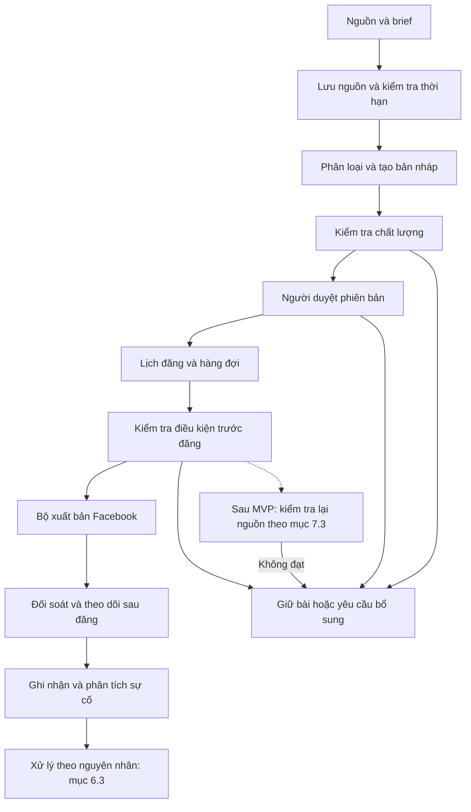
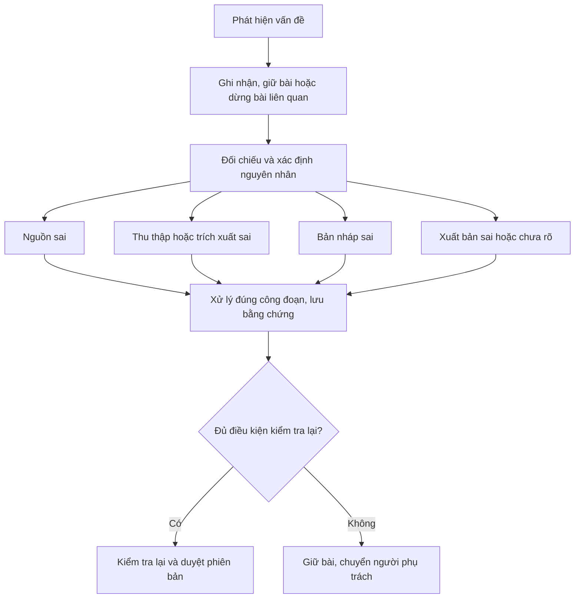

# AI FACEBOOK AUTO POSTER
## Tài liệu định hướng và yêu cầu sản phẩm — Draft v1.2
### Product Brief & Product Requirements Draft

| Thuộc tính | Giá trị |
| --- | --- |
| Phiên bản | Draft v1.2 |
| Ngày lập | 30/10/2026 |
| Ngày cập nhật | 02/11/2026 |
| Mã tài liệu | PB-PRD-001 |
| Mục đích | Lưu trữ cá nhân, thảo luận với người phụ trách và làm nền tảng xây dựng prototype/MVP |
| Trạng thái | Đề xuất để rà soát; chưa phải đặc tả triển khai đã được phê duyệt |
| Đối tượng ban đầu | Một Fanpage phục vụ cộng đồng địa phương |
| Chế độ MVP | AI hỗ trợ tạo bài; người quản trị duyệt trước khi đăng |

> Tài liệu tổng hợp ý tưởng gốc và bổ sung các khoảng trống về chất lượng thông tin, vận hành, bảo mật, thương mại và xử lý sự cố. Các ngưỡng, tỷ lệ và lựa chọn triển khai chưa có dữ liệu thực tế đều là đề xuất cần kiểm chứng. Khả năng tích hợp và chính sách Facebook phải được đối chiếu với tài liệu Meta và thử nghiệm tại thời điểm triển khai.

### Thay đổi chính trong v1.2

- Bổ sung tính năng sau MVP: **Source Revalidation & Publication Blocking** (Kiểm tra lại nguồn và chặn xuất bản); tự hủy chỉ theo điều kiện được phê duyệt.
- Dùng 48 giờ làm ngưỡng mặc định có cấu hình, tính từ lần kiểm tra thành công gần nhất; không coi đây là bảo đảm nguồn đúng tại thời điểm đăng.
- Xác định phạm vi theo sự phụ thuộc vào nguồn, phân biệt lỗi truy cập với thay đổi dữ kiện, đồng bộ phê duyệt, trạng thái, rủi ro và nghiệm thu sau MVP.
- Giữ nguyên các cải tiến v1.1 và phạm vi MVP bán tự động. Tài liệu vẫn là bản thảo để hai bên rà soát, chưa phải cam kết triển khai toàn bộ tính năng.

**Tên dùng trong dự án:** PostBot AI — Tài liệu định hướng và yêu cầu sản phẩm. Bản này kết hợp định hướng, yêu cầu cấp sản phẩm và nguyên tắc vận hành; kiến trúc ở mức khái niệm. Khi triển khai, cần đặc tả từng tính năng và thiết kế kỹ thuật riêng; tài liệu chưa thay thế chúng.

**Hướng dẫn đọc:** xem mục 20.6 để tra thuật ngữ và ví dụ. Các vai trò ở mục 3 là trách nhiệm khi thực hiện công việc, không phải phân chia cố định hai thành viên thành người làm nghiệp vụ và người làm kỹ thuật.

## Mục lục

1. Bài toán và mục tiêu
2. Nguyên tắc thiết kế
3. Vai trò và trách nhiệm
4. Phạm vi MVP và định hướng mở rộng
5. Chế độ vận hành và phân loại rủi ro
6. Kiến trúc khái niệm
7. Quản lý đầu vào và nguồn tin
8. Tạo nội dung và hình ảnh
9. Kiểm duyệt và phê duyệt
10. Luồng nghiệp vụ và trạng thái
11. Xuất bản, lịch đăng và xử lý lỗi
12. Vận hành sau đăng và đính chính
13. Bảo mật và quản lý dữ liệu
14. Thương mại hóa và quản trị biên tập
15. Đo lường, chi phí và tính khả thi
16. Danh mục rủi ro
17. Lộ trình và điều kiện chuyển giai đoạn
18. Tiêu chí nghiệm thu MVP
19. Các quyết định còn mở
20. Phụ lục biểu mẫu và tài liệu tham chiếu

Mục 18 gồm checklist MVP và một nhóm nghiệm thu sau MVP được tách riêng tại 18.4.

## 1. Bài toán và mục tiêu

### 1.1. Bài toán

Người vận hành trang địa phương phải tìm nguồn, viết lại thông tin, chuẩn bị ảnh, kiểm tra độ chính xác, đăng bài và xử lý phản hồi. Công việc lặp lại tiêu tốn thời gian, trong khi sai sót có thể ảnh hưởng đến uy tín của trang và người dân.

Hệ thống hỗ trợ người quản trị thực hiện các bước này theo một quy trình có thể theo dõi. Mức tự động hóa tăng dần dựa trên kết quả thực tế, không mặc định giao toàn bộ quyền xuất bản cho AI.

### 1.2. Mục tiêu kép

**Giai đoạn cộng đồng:** cung cấp thông tin địa phương hữu ích, có căn cứ, dễ hiểu; xây dựng uy tín và giảm thời gian sản xuất nội dung.

**Giai đoạn thương mại:** nhận bài tài trợ hoặc giới thiệu doanh nghiệp phù hợp để trang trải chi phí và có thể tái đầu tư cho hoạt động cộng đồng. Việc chuyển giai đoạn phụ thuộc cả chất lượng vận hành, nhu cầu khách hàng và khả năng tài chính.

### 1.3. Kết quả mong đợi

- Giảm tổng thời gian làm một bài, bao gồm cả thời gian kiểm tra và sửa lỗi.
- Truy được nguồn, phiên bản được duyệt, người duyệt và kết quả xuất bản.
- Có thể giữ bài, hủy bài và dừng lịch đăng khi chưa đủ điều kiện.
- Đo được giá trị cho người đọc và chi phí vận hành thực tế.
- Xây được quy trình xử lý sai sót sau đăng.

### 1.4. Những điều không cam kết

Hệ thống không bảo đảm tăng reach, tăng follower, tránh mọi hạn chế từ Facebook hoặc bảo đảm nội dung AI luôn đúng. Việc dùng thêm một AI kiểm tra cũng không được xem là xác minh độc lập nguồn tin.

## 2. Nguyên tắc thiết kế

1. **Độ tin cậy trước số lượng:** không đủ nguồn hoặc chưa được duyệt thì giữ bài.
2. **Có người chịu trách nhiệm:** từng loại nội dung phải có người quyết định cuối cùng.
3. **Duyệt đúng phiên bản:** thay đổi nội dung, ảnh, link hoặc đích đăng sau duyệt phải được xem xét lại.
4. **Tự động hóa theo rủi ro:** phân loại theo hậu quả nếu sai, bên cạnh phân loại cộng đồng/thương mại.
5. **Tuân theo khả năng nền tảng:** dùng phương thức tích hợp được hỗ trợ; không thiết kế dựa trên giả định “giả lập người dùng sẽ tránh bị phát hiện”.
6. **Có thể dừng và khôi phục:** mọi tác vụ quan trọng có trạng thái, lịch sử và đường xử lý lỗi.
7. **Tách dữ liệu khỏi lệnh:** tài liệu nguồn và brief không được tự thay đổi quy tắc hoặc quyền của bot.
8. **Đơn giản ở MVP:** một trang, ít nguồn, một kênh duyệt chính, giới hạn loại bài.
9. **Linh hoạt công nghệ có giới hạn:** tách bộ tạo nội dung khỏi bộ xuất bản, nhưng chưa xây hạ tầng nhiều nhà cung cấp khi chưa có nhu cầu.

## 3. Vai trò và trách nhiệm

| Vai trò | Trách nhiệm | Quyền chính |
| --- | --- | --- |
| Chủ dự án | Định hướng, ngân sách, chính sách biên tập và thương mại | Phê duyệt chính sách, quyết định sự cố lớn |
| Người biên tập | Nhập nguồn, tạo và sửa bản thảo | Tạo/sửa, gửi duyệt; không tự đổi quyền hệ thống |
| Người duyệt | Kiểm tra nguồn, ảnh, lịch và nội dung | Duyệt, từ chối, yêu cầu bổ sung |
| Người vận hành | Theo dõi hàng đợi, lỗi kết nối, kết quả đăng | Dừng lịch, xử lý tác vụ lỗi theo quyền |
| Người phụ trách phản hồi | Theo dõi phản ánh và đề xuất sửa sai | Chuyển sự cố, đề nghị sửa/gỡ |
| Hệ thống AI | Tạo bản nháp, trích xuất và gắn cờ | Không tự cấp quyền hoặc bỏ qua bước duyệt |

Hai thành viên đều có thể cùng làm nghiệp vụ, thiết kế, lập trình, kiểm thử và vận hành. Phân công theo từng công việc hoặc từng đợt phát hành, có thể luân phiên; không gắn một người cố định với business và người còn lại với kỹ thuật. Mỗi việc ghi một người phụ trách chính, người phối hợp và người kiểm tra/xác nhận; thay đổi phạm vi, ngân sách hoặc quyết định phát hành cần hai bên thống nhất.

Bảng trên mô tả các trách nhiệm vận hành và quyền trong hệ thống, không yêu cầu một người riêng cho mỗi vai trò. MVP có thể do một người kiêm nhiều vai trò nhưng vẫn ghi nhận người thực hiện và hành động. Khi có thể, người còn lại kiểm tra chéo trước khi xuất bản hoặc phát hành; nếu tự kiểm tra thì ghi rõ, không gọi là kiểm tra độc lập. Nội dung rủi ro cao chỉ mở khi có người đủ khả năng phụ trách. Xác định người thay thế khi người duyệt vắng mặt; nếu chưa có thì bài tiếp tục chờ.

## 4. Phạm vi MVP và định hướng mở rộng

### 4.1. Trong MVP

- Quản lý một Fanpage được chỉ định.
- Người quản trị nhập văn bản nguồn hoặc nguồn đã chọn; hệ thống lưu căn cứ tương ứng.
- Cấu hình giọng văn, thông tin địa phương và các quy tắc cơ bản.
- AI tạo bản nháp, đề xuất tiêu đề và đánh dấu chi tiết cần kiểm tra.
- Dùng ảnh do người quản trị cung cấp có thông tin nguồn/quyền sử dụng.
- Duyệt qua một giao diện chính; kênh thông báo chỉ hỗ trợ nhắc việc.
- Đăng ngay hoặc đặt lịch sau duyệt.
- Lưu lịch sử phiên bản, kết quả đăng và cảnh báo lỗi.
- Dừng lịch đăng, sửa/gỡ theo khả năng tích hợp đã xác minh; có phương án thao tác trực tiếp khi cần.
- Theo dõi thời gian làm bài, công sửa và chi phí cơ bản.

### 4.2. Chưa triển khai trong MVP

- Tự động đăng vào Group hoặc hồ sơ cá nhân.
- Thu thập tin tự động diện rộng.
- Tự đăng tin khẩn, tai nạn, cáo buộc, quyên góp hoặc thông tin nhạy cảm.
- Tự trả lời bình luận/inbox, tự chốt đơn hoặc xử lý thanh toán.
- Tự động tạo ảnh minh họa bằng AI; tự tối ưu theo tương tác; quản lý nhiều trang.
- Quản lý hợp đồng quảng cáo, phân bổ tiền tái đầu tư và báo cáo ROI đầy đủ.

### 4.3. Mở rộng có điều kiện

Tạo ảnh minh họa bằng AI có kiểm duyệt và nhận diện rõ, bình luận đầu tiên, bài tài trợ, thu thập nguồn tự động và chế độ tự đăng chỉ được bổ sung sau khi chứng minh được nhu cầu, khả năng nền tảng và quy trình kiểm soát tương ứng.

**Tính năng sau MVP:** Source Revalidation & Publication Blocking — kiểm tra lại nguồn và chặn xuất bản theo mục 7.3; tự hủy chỉ theo điều kiện đã được phê duyệt. Không yêu cầu xây bộ tự lấy lại URL trong MVP.

## 5. Chế độ vận hành và phân loại rủi ro

### 5.1. Chế độ

| Chế độ | Hành vi | Phạm vi |
| --- | --- | --- |
| Hỗ trợ thủ công | AI tạo nháp; người dùng tự đăng và ghi nhận kết quả | Dùng thử hoặc phương án dự phòng |
| Bán tự động | Người duyệt đúng phiên bản; hệ thống đăng ngay/đặt lịch | Mặc định MVP |
| Tự động có điều kiện | Chỉ tự đăng danh mục được cho phép, khi đủ điều kiện | Sau MVP |

Không có người duyệt không đồng nghĩa với được phép tự đăng. Chế độ hỗ trợ thủ công không thể bảo đảm chống đăng trùng ngoài hệ thống; cần ghi nhận đường dẫn và đối soát trước khi chuyển lại sang đăng bằng bot.

### 5.2. Phân loại hai trục

Mỗi bài có loại nội dung: **cộng đồng, thương mại hoặc kết hợp**; đồng thời có mức rủi ro riêng.

| Mức | Ví dụ | Quy trình đề xuất |
| --- | --- | --- |
| Thấp | Giới thiệu văn hóa, nội dung thường xanh đã xác minh | Người duyệt trong MVP; có thể đánh giá tự đăng sau |
| Trung bình | Lịch sự kiện, thông báo dịch vụ, chương trình ưu đãi | Kiểm tra ngày giờ, nguồn và thời hạn; bắt buộc duyệt |
| Cao | Thiên tai, tai nạn, cáo buộc, dữ liệu cá nhân, quyên góp | Giữ ngoài luồng MVP; người phụ trách kiểm tra và xử lý riêng |

Loại sản phẩm, khẳng định quảng cáo và nhóm người bị ảnh hưởng có thể làm tăng mức rủi ro. Người duyệt được tăng mức hoặc giữ bài; việc hạ mức phải có lý do được lưu lại.

### 5.3. Điều kiện tự đăng trong tương lai

Danh mục được cho phép, nguồn còn hiệu lực, không có cờ cần kiểm tra, không trùng bài, chưa vượt hạn mức, tài khoản đích hợp lệ và hệ thống không đang tạm dừng. Bất kỳ điều kiện nào không đạt đều chuyển về chờ duyệt. Chế độ này cần nghiệm thu riêng trước khi bật.

## 6. Kiến trúc khái niệm



### 6.1. Các thành phần

- **Kho nguồn:** căn cứ, thời gian lấy tin, hiệu lực và quyền sử dụng.
- **Kho ngữ cảnh:** địa danh, từ điển địa phương, cách xưng hô, thông tin thương hiệu; mỗi mục có người cập nhật và ngày rà soát.
- **Bộ điều phối:** phân loại nội dung, mức rủi ro và chế độ cho phép.
- **Bộ tạo nội dung:** sinh bản thảo theo dữ liệu được cấp.
- **Bộ kiểm tra:** đối chiếu dữ kiện, kiểm tra thiếu nguồn, thời hạn, link và nội dung trùng.
- **Giao diện duyệt:** hiển thị bản xem trước và căn cứ, lưu quyết định theo phiên bản.
- **Bộ lịch và hàng đợi:** quản lý thời điểm, hạn mức và trạng thái.
- **Bộ xuất bản:** giữ thông tin xác thực ở phía máy chủ, thực hiện các thao tác nền tảng đã được nghiệm thu.
- **Nhật ký và giám sát:** ghi lịch sử, cảnh báo lỗi và chi phí; liên kết dữ liệu qua từng công đoạn.
- **Quản lý sự cố:** giữ bài, phân tích nguyên nhân, giao người xử lý và kiểm soát điều kiện chạy lại; không tự động sửa quy tắc từ phản ánh chưa xác minh.

Bước kiểm tra trước đăng luôn kiểm tra phê duyệt, thời hạn và trạng thái dừng. Khi tính năng sau MVP được bật, kết quả kiểm tra lại nguồn là điều kiện bắt buộc bổ sung trước khi gửi bài; nhánh nét đứt biểu thị phần mở rộng.

### 6.2. Dữ liệu tối thiểu

| Thực thể | Trường quan trọng |
| --- | --- |
| Nguồn | ID, URL/tài liệu, người cung cấp, ngày nguồn, ngày lấy, nội dung làm căn cứ, ngày diễn ra, hạn hiệu lực |
| Bài viết | ID, loại, mức rủi ro, trang đích, trạng thái, người phụ trách |
| Phiên bản | ID phiên bản, nội dung, ảnh, link, danh sách nguồn, dấu thời gian, cấu hình/model tạo nháp |
| Phê duyệt | Phiên bản, người duyệt, thời điểm, quyết định, ghi chú, lịch/đích đã duyệt |
| Tác vụ đăng | ID, phiên bản, thời điểm, khóa chống trùng, số lần thử, kết quả, mã bài Facebook |
| Sự cố | Loại, mức độ, nguyên nhân đã xác nhận hoặc chưa rõ, bằng chứng, công đoạn lỗi, bài/phiên bản liên quan, người xử lý, thay đổi khắc phục, số lần tạo lại, hành động, kết quả và thời điểm kết thúc |
| Số liệu | Bài, thời điểm lấy, định nghĩa chỉ số, giá trị hoặc trạng thái không lấy được |
| Lần kiểm tra nguồn — sau MVP | Nguồn/phiên bản, lần thử gần nhất, lần thành công gần nhất, hạn kiểm tra tiếp theo, kết quả, dữ kiện thay đổi, bằng chứng so sánh, lỗi truy cập, số lần thử, chính sách và người xác nhận nếu có |
| Quan hệ bài–nguồn — sau MVP | Phiên bản bài, phiên bản nguồn, dữ kiện được nguồn hỗ trợ, mức thiết yếu, lý do miễn kiểm tra URL và người xác nhận |

### 6.3. Phân tích nguyên nhân và điều kiện xử lý lại

Vấn đề có thể được phát hiện khi kiểm tra bản nháp, khi duyệt hoặc sau đăng. Không mặc định mọi lỗi đều do nguồn và không tự chuyển mọi sự cố về bước lấy nguồn. Trong MVP, người phụ trách xác nhận nguyên nhân; AI chỉ hỗ trợ đối chiếu và gợi ý.

| Nguyên nhân | Căn cứ đối chiếu | Hướng xử lý |
| --- | --- | --- |
| Nguồn sai, thiếu hoặc hết hiệu lực | Nguồn lưu lúc làm bài và thông tin cập nhật đã kiểm tra | Bổ sung/thay nguồn, kiểm tra lại rồi mới tạo nháp |
| Thu thập hoặc trích xuất sai | Nội dung nguồn gốc so với dữ liệu hệ thống đã lấy | Sửa bước thu thập/trích xuất, kiểm tra đầu ra rồi mới tạo nháp |
| Bản nháp sai | Dữ liệu đầu vào đúng nhưng bản nháp thêm, thiếu hoặc đổi ý | Sửa bản nháp hoặc điều chỉnh hướng dẫn tạo; chỉ kiểm tra lại nguồn khi cần |
| Xuất bản sai phiên bản hoặc sai đích | Phiên bản được duyệt so với nội dung và trang thực tế | Xử lý bộ xuất bản và bài đã đăng; không mặc định tạo nháp hoặc đăng bài mới |
| Chưa rõ hoặc có nhiều nguyên nhân | Chưa đủ bằng chứng kết luận | Giữ bài, giao người phụ trách kiểm tra và ghi nhận từng nguyên nhân |

“Thu thập/trích xuất” bao gồm nhập dữ liệu, lấy nội dung từ URL và chuyển nội dung thành dữ kiện. Không mặc định công đoạn này do AI thực hiện. Thu thập tự động diện rộng vẫn ngoài MVP.



Điều kiện đi tiếp: đã xác nhận và khắc phục nguyên nhân liên quan, dữ liệu đủ và còn hiệu lực, chưa chạm giới hạn tạo lại, có người phụ trách. Chưa rõ nguyên nhân thì giữ bài; không tự chạy lại. Với lỗi xuất bản, đối soát và xác nhận cách khắc phục trước mọi tác vụ sửa/gỡ hoặc đăng theo mục 11–12.

**Kiểm soát tạo lại trong MVP:**

- Không tự lặp thao tác tạo nháp. Người biên tập chủ động yêu cầu và ghi lý do cùng thay đổi đầu vào/hướng dẫn; không gửi lại cùng dữ liệu và cấu hình chỉ để chờ kết quả khác.
- Đề xuất tối đa **hai lần AI tạo lại sau bản nháp đầu tiên cho mỗi yêu cầu bài viết**. Nếu vẫn không đạt thì giữ bài, chuyển sửa thủ công hoặc hủy. Đây là ngưỡng ban đầu cần kiểm chứng; sửa nguồn, đổi phiên bản hoặc khởi động lại tác vụ không tự đặt lại bộ đếm.
- Lỗi kỹ thuật tạm thời của lời gọi tạo nháp cần chính sách thử lại hữu hạn riêng, tính vào ngân sách và không được dùng để vượt giới hạn sửa nội dung. Lỗi xuất bản tuân theo mục 11.3.
- Mọi bản sửa phải được kiểm tra lại và duyệt đúng phiên bản theo mục 9.3. Tạo lại không khôi phục phê duyệt cũ và không tự kích hoạt đăng.
- Bài đã đăng đi theo quy trình sửa/gỡ/đính chính tại mục 12; không tạo bài thay thế tự động. Các thay đổi quy tắc chung cần người có quyền xem xét trước khi áp dụng.

### 6.4. Dấu vết dữ liệu qua từng công đoạn

Lưu liên kết theo yêu cầu và phiên bản: **nguồn làm căn cứ → dữ liệu trích xuất → bản nháp → phiên bản được duyệt → kết quả thực tế đã đăng**. Mỗi bước ghi thời điểm, người hoặc thành phần thực hiện và phiên bản cấu hình liên quan. Nếu nhập văn bản trực tiếp, ghi rõ dữ liệu người dùng cung cấp và bước trích xuất nào được bỏ qua.

Giữ căn cứ cũ khi bổ sung phiên bản mới, trong giới hạn quyền sử dụng và chính sách lưu trữ. Không ghi đè dữ liệu cũ khiến mất khả năng đối chiếu. Bộ kiểm tra đúng với nguồn không đủ chứng minh nguồn đúng; trường hợp chưa đủ bằng chứng phải giữ bài.

## 7. Quản lý đầu vào và nguồn tin

### 7.1. Quy tắc nguồn

- Ưu tiên nguồn trực tiếp, có người/tổ chức chịu trách nhiệm.
- Lưu đủ nội dung làm căn cứ theo quyền sử dụng cho phép, thay vì chỉ giữ URL có thể thay đổi.
- Tách trạng thái “đã có nguồn”, “đã kiểm tra” và “còn hiệu lực”.
- Nhiều bài sao chép cùng một tin không được xem là nhiều xác nhận độc lập.
- Thông tin từ khách hàng là khẳng định cần kiểm tra; không mặc định đúng vì đã trả phí.
- Nếu nguồn mâu thuẫn hoặc thiếu dữ kiện quan trọng, giữ bài để người phụ trách xử lý.

### 7.2. Kiểm tra trước tạo và trước đăng

Kiểm tra ngày/tháng/năm, địa điểm, đơn vị tổ chức, phạm vi áp dụng và cập nhật mới. Bài có thời hạn phải có mốc hết hiệu lực. Bài duyệt quá lâu cần kiểm tra lại theo loại nội dung; thời gian cụ thể do người phụ trách cấu hình.

MVP ưu tiên nguồn do người quản trị đưa vào. Việc tự lấy tin, quyền truy cập và quyền sử dụng lại nội dung là hạng mục cần đánh giá riêng trước mở rộng.

### 7.3. Sau MVP — Source Revalidation & Publication Blocking

**Mục tiêu:** giảm nguy cơ đăng bài dựa trên nguồn bên ngoài đã thay đổi, hết hiệu lực hoặc chưa thể kiểm tra lại. Truy cập được URL và không phát hiện thay đổi không chứng minh thông tin đúng. Tính năng không cam kết theo dõi liên tục hoặc bảo đảm nguồn không đổi trong khoảng từ kiểm tra đến gửi bài.

**Phạm vi:** bài chưa đăng có dữ kiện thiết yếu phụ thuộc nguồn ngoài có thể thay đổi, bao gồm URL, RSS, crawler và nội dung nhập tay có dẫn nguồn. RSS là luồng cập nhật nội dung; feed không còn mục cũ không đủ để kết luận bài nguồn đã bị xóa. Ưu tiên đối chiếu bài nguồn gốc nếu có.

| Trường hợp | Cách áp dụng |
| --- | --- |
| Tin tức/sự kiện tạo từ URL, RSS, crawler | Kiểm tra nguồn của dữ kiện thiết yếu |
| Người dùng chép thông báo từ website vào ô nhập | Vẫn kiểm tra URL nếu có; thiếu URL thì yêu cầu xác nhận thủ công có căn cứ |
| Evergreen có số liệu từ nguồn ngoài | Đánh giá theo dữ kiện và độ biến động; không miễn chỉ vì nhãn evergreen |
| Template chỉ chứa bố cục/câu chữ mẫu | Miễn kiểm tra URL nếu không có dữ kiện phụ thuộc nguồn ngoài |
| Marketing có giá, thời hạn, điều kiện | Kiểm tra hiệu lực và xác nhận dữ kiện; kiểm tra URL khi phụ thuộc nguồn ngoài |
| Nội dung nội bộ hoặc tự nhập không phụ thuộc nguồn ngoài | Không tự lấy lại URL; vẫn duyệt, kiểm tra thời hạn và người chịu trách nhiệm |

Miễn kiểm tra URL không miễn kiểm duyệt. Lưu lý do miễn và người xác nhận; không để AI tự chuyển loại bài để bỏ kiểm tra. Với bài nhiều nguồn, xác định nguồn cho từng dữ kiện thiết yếu; không tự bỏ nguồn hoặc sửa bài để vượt chặn. Nguồn thay thế cần được xác nhận và phiên bản liên quan được duyệt lại.

**Ngưỡng và thời điểm:**

- Mặc định đề xuất: đến hạn khi thời gian hiện tại trừ lần kiểm tra thành công gần nhất **lớn hơn hoặc bằng 48 giờ**. Không có lần thành công thì chưa đủ điều kiện.
- Đây là ngưỡng khởi đầu cần thử nghiệm. Cho phép ngưỡng ngắn hơn theo nội dung; quy tắc kiểm tra gần giờ đăng cho sự kiện phải được chốt trước khi mở tính năng.
- Kiểm tra điều kiện ngay trước khi gửi bài. Nếu đến hạn, giữ bài để kiểm tra lại; chưa có kết quả đạt thì không gửi. Dời lịch, thử lại hoặc khôi phục hàng đợi phải kiểm tra lại điều kiện.
- Nếu biết nguồn có cập nhật, kiểm tra ngay dù chưa đến 48 giờ. Lần truy cập thất bại không cập nhật mốc thành công.
- “Thành công” yêu cầu lấy được nội dung có thể đối chiếu, đánh giá dữ kiện liên quan và hiệu lực theo chính sách; chỉ phản hồi truy cập thành công là chưa đủ.

**Thay đổi đáng kể:** thay đổi ngày giờ, địa điểm, hủy/hoãn, giá, điều kiện, đối tượng, số liệu hoặc kết luận làm thay đổi ý nghĩa dữ kiện bài sử dụng. Thay menu, quảng cáo hoặc bố cục không mặc định là thay đổi đáng kể. So sánh với phiên bản nguồn làm căn cứ duyệt, không chỉ với lần tải gần nhất; chưa phân loại chắc chắn thì giữ bài để người phụ trách xem.

| Kết quả | Hành động |
| --- | --- |
| Dữ kiện liên quan không đổi, đủ căn cứ và còn hiệu lực | Ghi lần kiểm tra thành công; tiếp tục nếu các điều kiện khác đạt |
| Dữ kiện thiết yếu thay đổi | Chặn đăng, vô hiệu hóa duyệt liên quan, yêu cầu rà soát; không tự tạo/đăng bản mới |
| Timeout, giới hạn truy cập, đăng nhập, lỗi trích xuất | Giữ bài, thử hữu hạn rồi giao người phụ trách; không coi là nguồn sai |
| URL không tìm thấy | Giữ bài và kiểm tra nguồn thay thế; không tự kết luận thông tin sai hoặc sự kiện bị hủy |
| Bài quá hạn hiệu lực đã cấu hình | Chuyển Hết hạn, chặn gửi |
| Sự kiện được xác nhận đã hủy | Chặn bài cũ; chỉ tự hủy tác vụ chưa gửi nếu có quy tắc đã phê duyệt và bằng chứng |
| Chưa rõ, nhiều nguồn mâu thuẫn | Giữ bài và chuyển người phụ trách |

**Chặn và hủy:** chặn là giữ lại để xử lý, có thể tiếp tục sau khi đủ điều kiện; hủy là kết thúc tác vụ xuất bản cụ thể và lưu lý do, không xóa nội dung hay lịch sử. Không tự khôi phục tác vụ đã hủy khi nguồn truy cập lại được. Việc hủy không thu hồi yêu cầu đã gửi; đang gửi hoặc chưa xác định kết quả phải đối soát theo mục 11.3. Bài đã đăng thuộc mục 12, không tự gỡ bởi tính năng này.

**Giới hạn và ngoại lệ:** đặt số lần thử, thời gian chờ, hạn xử lý và ngân sách trước triển khai. Chạm giới hạn thì giữ bài, thông báo một sự cố có theo dõi; không thử vô hạn hoặc tự hủy vì hết lần thử. Người có quyền có thể xác nhận thủ công kèm bằng chứng, thời hạn và lý do khi không lấy lại được URL; không được vượt qua dữ kiện đã biết là sai hoặc bài đã hết hạn. Lưu riêng xác nhận thủ công, không giả ghi là máy đã kiểm tra thành công. Dữ liệu dùng để kiểm tra lại cũng tuân theo chống prompt injection tại mục 13.2.

## 8. Tạo nội dung và hình ảnh

### 8.1. Quy tắc viết

- Không thêm tên, số liệu, trích dẫn, trải nghiệm cá nhân hoặc chi tiết hiện trường không có trong nguồn.
- Không tự suy đoán phần thiếu; trả về danh sách câu hỏi cần bổ sung.
- Giữ nguyên ý nghĩa, phạm vi và mức độ chắc chắn của nguồn.
- Dùng từ địa phương khi phù hợp; không giả vờ là người chứng kiến.
- Không ép mọi bài theo Hook–Body–CTA. Tin thông báo ưu tiên thông tin thiết yếu; nội dung khẩn ưu tiên hướng dẫn rõ ràng.
- Bài thương mại phải kiểm tra giá, thời hạn, điều kiện áp dụng, số liên hệ và các khẳng định về sản phẩm.

Đầu ra gồm bản nháp, nguồn đã dùng, chi tiết cần kiểm tra và gợi ý ảnh. Điểm tự tin của AI, nếu có, chỉ là tín hiệu hỗ trợ; không thay thế bằng chứng.

### 8.2. Quy tắc hình ảnh

- MVP ưu tiên ảnh đã xác định nguồn và quyền sử dụng.
- Không dùng ảnh AI làm bằng chứng hiện trường hoặc trình bày như ảnh chụp sự kiện thực tế. Đây là nguyên tắc xuyên suốt, không chỉ là giới hạn MVP.
- Nếu mở tính năng ảnh AI sau MVP, ảnh được sử dụng phải ghi rõ là “Ảnh minh họa do AI tạo”; không sử dụng nếu vẫn có nguy cơ khiến người đọc hiểu sai sự kiện.
- Ảnh minh họa từ nguồn khác cũng cần nhận diện rõ khi có khả năng gây hiểu nhầm. Nhãn minh họa không thay thế việc kiểm tra tính phù hợp của ảnh.
- Kiểm tra khuôn mặt, địa danh, logo, chữ, giá và số điện thoại trong ảnh.
- Việc ghi nguồn không mặc nhiên cấp quyền sử dụng.
- Ảnh là một phần của phiên bản được duyệt; thay ảnh phải duyệt lại.

## 9. Kiểm duyệt và phê duyệt

### 9.1. Kiểm tra tự động

Hệ thống đối chiếu dữ kiện với nguồn, cảnh báo nội dung không được hỗ trợ, ngày hết hạn, nguồn mâu thuẫn, dữ liệu cá nhân, link sai, bài trùng và các khẳng định nhạy cảm. Bộ lọc từ khóa chỉ là một lớp hỗ trợ vì ngữ cảnh có thể làm thay đổi ý nghĩa.

### 9.2. Màn hình duyệt

Hiển thị bản xem trước chữ/ảnh/link; nguồn; các chi tiết cần kiểm tra; loại và mức rủi ro; trang đích; thời điểm đăng; thông tin tài trợ nếu có. Người duyệt có thể duyệt, từ chối, sửa hoặc yêu cầu bổ sung và xem khác biệt giữa các phiên bản.

### 9.3. Ràng buộc

- Phê duyệt gắn với phiên bản nội dung, nguồn làm căn cứ, trang đích và lịch đăng.
- Đổi nội dung/ảnh/link/trang đích hoặc đổi lịch thủ công làm mất hiệu lực duyệt và cần xác nhận lại.
- Khi nguồn hoặc hạn hiệu lực thay đổi, bài phải được rà soát lại. Sau MVP, thay đổi dữ kiện thiết yếu trong căn cứ duyệt làm vô hiệu phê duyệt liên quan; thay đổi giao diện không ảnh hưởng dữ kiện không bắt buộc duyệt lại. Lỗi truy cập làm chặn xuất bản trong lúc chờ kiểm tra, không tự kết luận nội dung đã duyệt sai.
- Bài chờ quá hạn không được tự đăng; thông báo và giữ/hủy theo cấu hình.
- Bản xem trước chỉ mang tính gần đúng nếu Facebook hiển thị khác; các thành phần quan trọng phải được kiểm tra trong thử nghiệm tích hợp.

## 10. Luồng nghiệp vụ và trạng thái

### 10.1. Luồng chuẩn

1. Người biên tập tạo yêu cầu, chỉ định nguồn, loại bài và trang đích.
2. Hệ thống kiểm tra nguồn, thời hạn và điều kiện đầu vào.
3. AI tạo bản nháp; bộ kiểm tra trả về cảnh báo.
4. Người biên tập sửa và gửi duyệt.
5. Người duyệt kiểm tra đúng phiên bản cùng nguồn, ảnh và lịch.
6. Trước xuất bản, hệ thống kiểm tra lại hiệu lực duyệt, hạn bài, trạng thái dừng và khả năng kết nối. Sau MVP, áp dụng thêm điều kiện nguồn theo mục 7.3 trước khi gửi.
7. Bộ xuất bản gửi bài; lưu kết quả và mã bài nếu thành công.
8. Đối soát kết quả; theo dõi phản ánh và số liệu.

### 10.2. Trạng thái nghiệp vụ

| Trạng thái | Ý nghĩa và hành động tiếp theo |
| --- | --- |
| Nháp | Có thể sửa hoặc tạo lại |
| Cần bổ sung | Thiếu nguồn/dữ kiện; chưa thể duyệt |
| Chờ duyệt | Người duyệt xem phiên bản cụ thể |
| Bị từ chối | Có lý do; sửa sẽ tạo phiên bản mới |
| Đã duyệt | Đủ điều kiện vào lịch/hàng đợi |
| Đã lên lịch | Chờ kiểm tra trước đăng |
| Đang đăng | Tác vụ đã bắt đầu; ngăn tác vụ khác đăng cùng yêu cầu |
| Chưa xác định kết quả | Có khả năng đã đăng; cần đối soát trước thử lại |
| Đăng thất bại | Lỗi đã xác định; xử lý theo loại lỗi |
| Đã đăng | Có căn cứ xác nhận kết quả và đường dẫn/mã bài |
| Hết hạn hoặc đã hủy | Không được tiếp tục đăng |
| Cần đính chính | Bài đã đăng có phản ánh cần xử lý |
| Đã sửa hoặc gỡ | Lưu lịch sử và căn cứ hành động |

Sau MVP, trạng thái kiểm tra nguồn được quản lý riêng với trạng thái bài: **Không áp dụng / Chưa kiểm tra / Còn hiệu lực / Đến hạn / Đang kiểm tra / Cần rà soát / Không thể kiểm tra**. Bài bị giữ có lý do, người phụ trách và điều kiện mở chặn. Nguồn quay lại không tự kích hoạt bài cũ; kiểm tra lại lịch, thời hạn, duyệt và trạng thái hủy trước khi cho tiếp tục.

Sửa/gỡ là một quy trình có phê duyệt và tác vụ riêng; thất bại khi sửa/gỡ phải có cảnh báo. Tạm dừng toàn hệ thống là trạng thái vận hành, không tự xóa hoặc đánh dấu hủy mọi bài.

## 11. Xuất bản, lịch đăng và xử lý lỗi

### 11.1. Xác minh khả năng nền tảng trước triển khai

Thử nghiệm trên đúng tài khoản/trang dự kiến dùng: đăng chữ, ảnh, lấy mã bài, bình luận, sửa/gỡ và lấy các chỉ số cần thiết. Ghi rõ phương thức tích hợp, phiên bản API, quyền cần có, điều kiện xét duyệt nếu áp dụng, lỗi và giới hạn quan sát được.

Fanpage, Group và hồ sơ cá nhân phải được đánh giá riêng. Chưa xác minh thì không đưa vào cam kết sản phẩm. Nếu tích hợp chưa đáp ứng, có thể dùng chế độ tạo nháp và đăng thủ công.

### 11.2. Lịch đăng

- Mặc định sử dụng múi giờ Asia/Ho_Chi_Minh và hiển thị rõ cho người duyệt.
- Cấu hình hạn mức ngày, khoảng cách tối thiểu và giờ được phép đăng.
- Không đăng dồn toàn bộ bài trễ sau khi hệ thống hoạt động trở lại; kiểm tra lại từng bài.
- Không thêm trễ ngẫu nhiên cho thông báo cần đúng giờ. Nếu tương lai cho phép khoảng giờ linh hoạt thì người duyệt phải biết khoảng đó.
- Chọn giờ đăng dựa trên nhu cầu và thử nghiệm; không cam kết trễ ngẫu nhiên giúp tránh giảm reach.

### 11.3. Chống đăng trùng và thử lại

Mỗi yêu cầu/phiên bản/trang đích có khóa nội bộ để ngăn tác vụ trùng và lưu lịch sử thử. Khóa nội bộ không bảo đảm Facebook chỉ nhận đúng một lần khi kết nối bị gián đoạn.

Nếu gửi yêu cầu nhưng không nhận kết quả, chuyển sang “chưa xác định kết quả”. Đối soát bằng khả năng nền tảng hỗ trợ; nếu không xác định chắc chắn, yêu cầu người vận hành kiểm tra thay vì tự gửi lại. Lỗi tạm thời chỉ thử lại có giới hạn; lỗi quyền hoặc xác thực phải cảnh báo và dừng tác vụ liên quan.

### 11.4. Bình luận phụ trợ

Đây là hạng mục sau MVP, chỉ mở sau thử nghiệm quyền thực tế. Tác vụ bình luận tách khỏi tác vụ bài chính. Bình luận thất bại không làm đăng lại bài chính. Nguồn, điều kiện ưu đãi hoặc thông tin thiết yếu không được phụ thuộc hoàn toàn vào bình luận.

### 11.5. Dừng khẩn cấp

Nút dừng ngăn tác vụ mới bắt đầu, hiển thị tác vụ đang chạy và không hứa có thể hủy yêu cầu đã gửi. Sau khi dừng, đối soát các bài có thể đã đăng. Chỉ tiếp tục khi người có quyền xác nhận.

### 11.6. Điều kiện nguồn trước gửi — sau MVP

Áp dụng mục 7.3 tại thời điểm bắt đầu gửi, bao gồm tác vụ chạy lại hoặc trễ lịch. Nếu kết quả kiểm tra đến muộn, hoặc nguồn/phiên bản/lịch liên quan đã đổi trong lúc kiểm tra, đánh giá lại trên phiên bản hiện hành; kết quả cũ không được mở chặn nhầm. Tác vụ bị chặn không được bộ thử lại xuất bản tự động bỏ qua. Giữ bài khi module kiểm tra nguồn lỗi; hiển thị nguyên nhân và chuyển người phụ trách. Thử lại nguồn và thử lại xuất bản là hai loại tác vụ riêng.

## 12. Vận hành sau đăng và đính chính

### 12.1. Theo dõi

Chỉ định người nhận phản ánh và khung giờ theo dõi thực tế. MVP có thể kiểm tra bình luận trực tiếp trên Facebook; không mặc định đã có khả năng thu thập tự động. Ngoài giờ trực, không tự đăng những loại bài cần phản ứng nhanh.

### 12.2. Khi có phản ánh sai thông tin

1. Ghi nhận đường dẫn, nội dung phản ánh và mức ảnh hưởng.
2. Tạm dừng các bài liên quan nếu cần.
3. Đối chiếu nguồn, dữ liệu trích xuất, bản nháp, phiên bản được duyệt và nội dung thực tế đã đăng; xác định công đoạn gây lỗi theo mục 6.3. Nếu chưa rõ, giữ các bài liên quan để người phụ trách kiểm tra.
4. Người phụ trách quyết định sửa, gỡ, giải thích hoặc đăng đính chính.
5. Thực hiện, xác nhận kết quả và ghi lịch sử.
6. Khắc phục đúng công đoạn, lưu bằng chứng và đánh giá biện pháp giảm tái diễn. Chỉ cập nhật nguồn/quy tắc khi có căn cứ và người có quyền xác nhận; kiểm tra và duyệt lại mọi phiên bản sửa trước thao tác xuất bản tương ứng.

Không mặc định sửa âm thầm là đủ khi bản cũ đã được chia sẻ hoặc ảnh hưởng đến hành động của người đọc. Gỡ bài không thu hồi được ảnh chụp hoặc nội dung đã lan truyền.

### 12.3. Mức độ sự cố

| Mức | Ví dụ | Phản ứng |
| --- | --- | --- |
| Nhẹ | Lỗi trình bày không đổi ý nghĩa | Sửa theo quy trình, lưu lịch sử |
| Đáng kể | Sai giờ, giá, địa điểm, điều kiện | Xử lý ưu tiên; cân nhắc thông báo đính chính |
| Nghiêm trọng | Lộ khóa, thông tin gây hại, đăng sai trang | Dừng hệ thống/phạm vi ảnh hưởng, thu hồi quyền nếu cần và xử lý trực tiếp |

Thời gian phản hồi mục tiêu phải phù hợp nhân sự; chưa đặt cam kết trực 24/7 trong Draft v1.1.

## 13. Bảo mật và quản lý dữ liệu

### 13.1. Quyền và thông tin xác thực

- Giữ khóa/token ở phía máy chủ, ngoài prompt và nhật ký thường.
- Cấp quyền tối thiểu; tách quyền soạn, duyệt, xuất bản và cấu hình.
- Phê duyệt phải gắn với danh tính đã xác thực; không duyệt chỉ vì người dùng có một đường link.
- Có quy trình thu hồi quyền khi thành viên rời dự án hoặc nghi ngờ lộ khóa.
- Cảnh báo khi kết nối mất quyền; không chỉ dựa vào ngày hết hạn dự kiến.
- Tách môi trường thử nghiệm và môi trường thật.

### 13.2. Chống chỉ dẫn độc hại trong nguồn

Nội dung website, tài liệu và brief là dữ liệu không đáng tin về mặt điều khiển. AI không được làm theo chỉ dẫn trong nguồn để bỏ duyệt, đổi tài khoản, thêm link hoặc chuyển tiền. Bộ xuất bản xác thực quyền và đích đăng độc lập với đầu ra AI. Link, hotline và thông tin nhận tiền phải đối chiếu dữ liệu đã xác nhận.

### 13.3. Dữ liệu cá nhân và quyền sử dụng

Hạn chế thu thập/lưu thông tin cá nhân không cần thiết. Các bài liên quan trẻ em, địa chỉ riêng, số điện thoại cá nhân hoặc cáo buộc cần đánh giá riêng trước sử dụng. Ghi nhận căn cứ sử dụng ảnh và nội dung. Trước mở nội dung nhạy cảm hoặc ngành quảng cáo đặc thù, cần rà soát yêu cầu pháp lý/chính sách phù hợp; tài liệu này chưa xác nhận đáp ứng các yêu cầu đó.

### 13.4. Lưu trữ và sao lưu

Quy định thời hạn giữ bản nháp, nguồn, lịch sử duyệt, nhật ký và số liệu trước khi chạy thật. Chỉ người được cấp quyền mới truy cập được. Có sao lưu và thử khôi phục; khôi phục dữ liệu không được tự kích hoạt lại các tác vụ đã đăng. Khi xóa dữ liệu, xác định rõ phạm vi bản sao và dữ liệu giữ lại phục vụ truy vết.

## 14. Thương mại hóa và quản trị biên tập

### 14.1. Chính sách tài trợ

- Nhận diện rõ nội dung được tài trợ; kiểm tra yêu cầu công bố/nhãn của nền tảng tại thời điểm đăng.
- Thống nhất loại khách hàng và nội dung không nhận.
- Không để việc tài trợ mặc định quyết định nội dung biên tập hoặc che giấu phản ánh liên quan.
- Có người quyết định khi nhà tài trợ trở thành đối tượng của thông tin bất lợi.
- Khách hàng xác nhận dữ kiện sản phẩm và phiên bản quảng cáo; phía trang vẫn chịu trách nhiệm quyết định xuất bản.

### 14.2. Tỷ lệ nội dung

80% cộng đồng / 20% thương mại là giả thuyết ban đầu. Đề xuất thử giới hạn số bài có yếu tố thương mại không vượt 20% trong 30 ngày liên tiếp; bài kết hợp vẫn tính là thương mại. Với lượng bài nhỏ phải quy định cách làm tròn trước khi áp dụng. Đây chưa phải quy tắc cố định đã chứng minh hiệu quả.

Không tạo thêm bài cộng đồng chất lượng thấp chỉ để đủ tỷ lệ. Nếu vượt hạn mức, giữ hoặc dời bài tài trợ; không cam kết lịch với khách hàng trước khi kiểm tra sức chứa lịch đăng.

### 14.3. Brief và nghiệm thu thương mại

Brief cần có mục tiêu, đối tượng, dữ kiện sản phẩm, bằng chứng cho khẳng định, giá/ưu đãi, điều kiện, hạn chót, link, ảnh, quyền sử dụng, người xác nhận và tiêu chí nghiệm thu. Thỏa thuận rõ cách xử lý hủy/sửa, sự cố nền tảng và kết quả không đạt kỳ vọng.

Reach/tương tác không đồng nghĩa với doanh thu. Chỉ báo cáo hiệu quả bán hàng khi có cách đo phù hợp và được phép sử dụng dữ liệu. Không hứa doanh số từ số follower.

### 14.4. Tái đầu tư

Tách nguồn thu, chi phí vận hành và ngân sách hoạt động cộng đồng. Chỉ công bố khoản đóng góp sau khi có căn cứ. Quy trình tài chính chi tiết thuộc giai đoạn thương mại, chưa tự động hóa trong MVP.

## 15. Đo lường, chi phí và tính khả thi

### 15.1. Chỉ số chất lượng và vận hành

| Chỉ số | Định nghĩa đề xuất |
| --- | --- |
| Thời gian làm bài | Tổng thời gian con người tìm/nhập nguồn, sửa, duyệt và xử lý lỗi cho mỗi bài hoàn tất |
| Tỷ lệ cần sửa nhiều | Số nháp phải viết lại ý chính hoặc sửa dữ kiện / số nháp đã được xem xét |
| Lỗi sau đăng | Số bài xác nhận sai thông tin / số bài đã đăng trong kỳ |
| Thành công xuất bản | Yêu cầu đã xác nhận đăng thành công / yêu cầu hợp lệ đến hạn; báo cáo riêng bài hủy và kết quả chưa xác định |
| Độ trễ lịch đăng | Thời điểm xác nhận đăng so với lịch đã duyệt; tách lỗi hệ thống khỏi trễ duyệt |
| Chi phí một bài | Chi phí phân bổ trong kỳ / số bài được duyệt và đăng thành công |
| Giá trị cộng đồng | Phản hồi hữu ích, mức quay lại, nhu cầu thông tin; dùng cả đánh giá định tính |

### 15.2. Tương tác và giới hạn dữ liệu

Nếu dùng tỷ lệ tương tác theo reach, ghi rõ: tổng loại tương tác đã thống nhất chia cho reach của bài, nhân 100%. Tỷ lệ theo follower phải có tên riêng, không so sánh như cùng chỉ số. Chọn một cửa sổ đo sau đăng và cách tổng hợp trước thử nghiệm; không lấy một bài nổi bật làm đại diện.

Các trường dữ liệu phụ thuộc quyền và khả năng nền tảng. Thiếu dữ liệu được ghi “không có”, không đổi thành số 0. Chưa cam kết lấy được mọi loại chỉ số hoặc tính được ROI.

### 15.3. Chi phí

Chi phí đầy đủ gồm AI tạo/kiểm tra/sinh lại, ảnh, máy chủ, lưu trữ, giám sát, công biên tập, duyệt, tìm nguồn, xử lý phản ánh và bảo trì tích hợp. Phải tính cả bản nháp bị loại.

Ngân sách cần có trần theo kỳ và giới hạn số lần sinh lại. Áp dụng bộ đếm và điều kiện dừng ở mục 6.3; tính cả lần tạo lại thất bại và lời gọi thử lại kỹ thuật vào chi phí. Chạm trần thì dừng tác vụ AI mới hoặc chuyển sang thủ công; không bỏ kiểm tra để tiết kiệm. Đặt thời hạn thử nghiệm và ngân sách lỗ tối đa cho giai đoạn chưa có doanh thu.

## 16. Danh mục rủi ro

Mức ưu tiên dưới đây là đánh giá ban đầu theo hậu quả, chưa phải xác suất đã đo.

| Rủi ro | Ưu tiên | Kiểm soát chính | Phần còn lại |
| --- | --- | --- | --- |
| Không có tích hợp phù hợp | Cao | Thử nghiệm cổng đăng trước phát triển sâu | Chính sách/quyền có thể thay đổi |
| Nguồn sai hoặc hết hiệu lực | Cao | Lưu căn cứ, hạn sử dụng, kiểm tra trước đăng | Nguồn có thể cập nhật ngoài thời gian theo dõi |
| Kiểm tra lại nguồn gây chặn/hủy nhầm hoặc bỏ sót thay đổi — sau MVP | Cao | So sánh dữ kiện, giữ khi chưa rõ, tự hủy có điều kiện, truy vết và xử lý thủ công | Nguồn có thể đổi sau kiểm tra; AI có thể phân loại sai |
| AI thêm dữ kiện | Cao | Đối chiếu nguồn, người duyệt | Bộ kiểm tra vẫn có thể bỏ sót |
| Xử lý lại sai công đoạn hoặc lặp tạo nháp | Cao | Phân tích nguyên nhân, lưu dấu vết, giới hạn tạo lại, giữ bài khi chưa rõ | Chẩn đoán có thể sai; cần người phụ trách |
| Duyệt hình thức | Cao | Cảnh báo tập trung, giao diện có nguồn, giới hạn tải | Con người vẫn có thể nhầm |
| Đăng sai phiên bản/trang | Cao | Ràng buộc phê duyệt, kiểm tra trước gửi | Cấu hình ban đầu sai vẫn cần người phát hiện |
| Đăng trùng do timeout | Cao | Khóa nội bộ, trạng thái chưa xác định, đối soát | Không bảo đảm đúng một lần từ phía nền tảng |
| Lộ khóa hoặc tài khoản duyệt | Cao | Quyền tối thiểu, bảo vệ khóa, thu hồi | Có thể phải xử lý trực tiếp ngoài bot |
| Prompt injection | Cao | Cô lập nguồn, xác thực thao tác ngoài AI | Đầu ra vẫn cần kiểm tra |
| Ảnh gây hiểu nhầm, vi phạm quyền | Cao | Kiểm tra nguồn/quyền, quy tắc ảnh minh họa | Có thể phát sinh khiếu nại |
| Không có người xử lý sau đăng | Cao | Khung giờ trực, người thay thế, giới hạn loại bài | Không phù hợp vận hành tin khẩn 24/7 |
| Mất niềm tin khi thương mại hóa | Trung bình–cao | Minh bạch tài trợ, độc lập biên tập | Cảm nhận độc giả cần theo dõi |
| Chi phí vượt giá trị | Trung bình–cao | Đo tổng công, trần ngân sách, thời hạn thử | Sản lượng thấp có thể không kinh tế |
| Tối ưu tương tác làm giảm chất lượng | Trung bình–cao | KPI chất lượng và giá trị cộng đồng | Cần đánh giá biên tập định kỳ |
| Lịch chạy lại sau sự cố | Cao | Kiểm tra hạn bài, không xả hàng đợi tự động | Cần người rà soát khi gián đoạn dài |

## 17. Lộ trình và điều kiện chuyển giai đoạn

### Giai đoạn 0 — Kiểm chứng tính khả thi

Xác định trang, chủ sở hữu, loại bài, nguồn, người duyệt và ngân sách. Thử nghiệm tích hợp, kiểm tra quyền thực tế và các tình huống lỗi. Kết quả: biên bản khả năng được hỗ trợ cùng lựa chọn tự động hay thủ công.

### Giai đoạn 1 — Prototype quy trình

Tập trung vào nhập nguồn → tạo nháp → xem căn cứ → sửa → duyệt phiên bản. Chưa cần đăng thật. Dùng bài mẫu có nguồn cũ, thiếu dữ kiện, mâu thuẫn và nội dung chỉ dẫn độc hại để kiểm tra hành vi giữ bài.

### Giai đoạn 2 — MVP bán tự động

Một Fanpage, nội dung rủi ro thấp, mọi bài được người duyệt. Bổ sung lịch đăng, đối soát, nhật ký, dừng khẩn cấp và quy trình sửa sai. Thử trên tập bài và khoảng thời gian thống nhất trước khi bắt đầu; ví dụ 20–30 bài là gợi ý thử nhỏ, chưa đủ chứng minh an toàn cho mọi loại tin.

### Giai đoạn 3 — Thử nghiệm thương mại

Chỉ mở khi quy trình ổn định, xác định được chi phí, có nhu cầu khách hàng và chính sách tài trợ. Thử ít khách hàng, không tự xây đầy đủ hệ thống hợp đồng khi chưa cần.

Mốc 10.000 follower và tương tác trên 5% trong ý tưởng gốc được giữ như mục tiêu tham khảo, không làm điều kiện cứng duy nhất. Quy mô nhỏ vẫn có thể thử thương mại nếu phù hợp; quy mô lớn không thay thế chất lượng và khả năng vận hành.

### Giai đoạn 4 — Tự động hóa có điều kiện

Chỉ mở danh mục đã chứng minh ổn định. Có tiêu chí định lượng được thống nhất trước thử nghiệm, cơ chế tắt nhanh và người chịu trách nhiệm. Thu thập nguồn, ảnh AI, nhiều trang và tối ưu lịch được nghiệm thu riêng; không mở tất cả đồng thời.

Kiểm tra lại nguồn theo mục 7.3 là hạng mục sau MVP có nghiệm thu riêng; có thể ưu tiên trước chế độ tự đăng, không phụ thuộc việc mở thương mại. Không coi đó là điều kiện bắt buộc để hoàn tất MVP hiện tại.

## 18. Tiêu chí nghiệm thu MVP và mở rộng sau MVP

### 18.1. Chức năng và quyền

- [ ] Có biên bản thử nghiệm khả năng đăng thực tế trên trang đích.
- [ ] Người không có quyền không thể duyệt, đổi trang hoặc kích hoạt đăng.
- [ ] Bài thiếu nguồn/dữ kiện thiết yếu bị giữ lại.
- [ ] Bản xem trước gồm nội dung, ảnh, link, nguồn, lịch và trang đích.
- [ ] Chỉ phiên bản được duyệt mới được xuất bản.
- [ ] Sửa sau duyệt khiến phiên bản phải được duyệt lại.
- [ ] Bài hết hạn hoặc hệ thống đang dừng không bắt đầu đăng.

### 18.2. Độ tin cậy vận hành

- [ ] Bấm đăng hai lần hoặc chạy hai tác vụ cùng yêu cầu không tạo hai lần gửi bình thường.
- [ ] Mất phản hồi sau gửi chuyển sang chưa xác định; không tự đăng lại khi chưa đối soát.
- [ ] Mất quyền kết nối có cảnh báo và giữ bài.
- [ ] Khôi phục sau gián đoạn không tự đăng dồn bài cũ.
- [ ] Lưu được kết quả, mã bài/đường dẫn khi xác nhận thành công.
- [ ] Dừng khẩn cấp chặn tác vụ mới và hiển thị tác vụ đang chạy.
- [ ] Có đường xử lý sửa/gỡ và phương án thao tác trực tiếp khi tích hợp không hỗ trợ.
- [ ] Khôi phục sao lưu không kích hoạt lại tác vụ đã xử lý.

### 18.3. Chất lượng và bảo mật

- [ ] Nguồn chứa chỉ dẫn độc hại không thể thay đổi quyền hoặc đích đăng.
- [ ] Không có khóa/token trong nội dung AI, giao diện hoặc nhật ký thường.
- [ ] Có lịch sử người tạo, người duyệt, phiên bản và hành động.
- [ ] Có người nhận phản ánh và thử ít nhất một tình huống đính chính.
- [ ] Ba tình huống nguồn sai, trích xuất sai và bản nháp sai được định tuyến về đúng công đoạn; chưa rõ nguyên nhân thì giữ bài.
- [ ] Tình huống xuất bản sai phiên bản được đối soát và xử lý riêng, không tự tạo hoặc đăng bài thay thế.
- [ ] Có thể đối chiếu nguồn → dữ liệu trích xuất → bản nháp → bản được duyệt → kết quả thực tế đã đăng.
- [ ] Không tự lặp tạo nháp; yêu cầu tạo lại phải có lý do và thay đổi được ghi nhận.
- [ ] Chạm giới hạn hai lần tạo lại thì giữ bài; đổi phiên bản hoặc khởi động lại không đặt lại bộ đếm.
- [ ] Bản sửa được kiểm tra và duyệt lại; không kế thừa phê duyệt cũ để tự đăng.
- [ ] MVP không cung cấp chức năng tạo ảnh AI; quy tắc không dùng ảnh AI như bằng chứng hiện trường được thể hiện trong hướng dẫn duyệt. Nếu mở ảnh AI sau MVP, phải nghiệm thu riêng việc ghi nhãn và từ chối ảnh gây hiểu nhầm.
- [ ] Đo được tổng thời gian con người và chi phí trên bài hoàn tất.

Việc hoàn thành checklist chứng minh các hành vi đã kiểm thử trong phạm vi cụ thể, không phải bảo đảm không còn lỗi. Kết quả thử phải ghi đầu vào, kết quả mong đợi/thực tế và người xác nhận.

### 18.4. Nghiệm thu kiểm tra lại nguồn — chỉ sau MVP

- [ ] Chưa có lần thành công hoặc đạt ngưỡng 48 giờ thì giữ bài và kiểm tra trước gửi; kiểm thử cả mốc ngay dưới và đúng 48 giờ.
- [ ] Lần thất bại không làm mới mốc thành công; phản hồi truy cập được nhưng thiếu nội dung không được coi là đạt.
- [ ] Đổi ngày/địa điểm/hủy sự kiện làm chặn và yêu cầu rà soát; thay giao diện đơn thuần không gây hủy nhầm.
- [ ] Timeout, lỗi quyền truy cập, URL mất và lỗi trích xuất được phân biệt với nguồn sai; chạm giới hạn thì chuyển người xử lý.
- [ ] Bài nhiều nguồn có thể truy dữ kiện thiết yếu về nguồn; không tự bỏ nguồn hoặc dữ kiện để đăng.
- [ ] Nhập tay/evergreen không tự vượt kiểm tra khi vẫn phụ thuộc nguồn ngoài; ngoại lệ có quyền và bằng chứng.
- [ ] RSS mất mục cũ không tự hủy bài; kiểm tra nguồn gốc khi có.
- [ ] Bài quá hạn không được đăng; hủy tác vụ lưu lý do và không tự khôi phục.
- [ ] Kết quả kiểm tra cũ không mở chặn phiên bản mới; dời lịch, phục hồi và thử lại đều qua kiểm tra trước gửi.
- [ ] Không hủy/gỡ bài đã đăng tự động; yêu cầu đã gửi hoặc chưa rõ kết quả phải đối soát.
- [ ] Có nhật ký, cảnh báo, trần chi phí và thử nghiệm sai phân loại trên bộ nguồn mẫu đã ghi kết quả mong đợi.

## 19. Các quyết định còn mở

| Câu hỏi | Thời điểm cần chốt |
| --- | --- |
| Ngưỡng kiểm tra theo loại bài, quy tắc gần giờ đăng, giới hạn thử và ai duyệt ngoại lệ nguồn? | Trước mở tính năng sau MVP |
| Trường hợp nào được tự hủy và bằng chứng nào đủ để xác nhận? | Trước mở tính năng sau MVP |
| Trang cụ thể, chủ sở hữu và quyền truy cập là gì? | Trước thử nghiệm tích hợp |
| Ai là người sử dụng chính và số bài dự kiến? | Trước prototype |
| Nguồn nào được chấp nhận và ai cập nhật kho địa phương? | Trước tạo nội dung thực tế |
| Ai duyệt, ai thay thế, khung giờ theo dõi? | Trước chạy MVP |
| Chọn dashboard hay kênh duyệt khác làm nơi quyết định chính? | Trước xây luồng duyệt |
| Hạn hiệu lực và điều kiện duyệt lại theo từng loại bài? | Trước lên lịch thật |
| Trần ngân sách và thời hạn thử nghiệm? | Trước vận hành |
| Thời hạn lưu/xóa dữ liệu và cách sao lưu? | Trước chạy thật |
| Tiêu chí giảm công, lỗi chấp nhận được và điều kiện dừng? | Trước thử nghiệm đánh giá |
| Chính sách tài trợ, ngành hàng và xung đột lợi ích? | Trước nhận quảng cáo |
| Thông tin/công cụ đo nào thực sự được nền tảng hỗ trợ? | Trước cam kết báo cáo |

## 20. Phụ lục

### 20.1. Mẫu yêu cầu bài viết

```yaml
ma_yeu_cau: ""
nguoi_phu_trach: ""
trang_dich: ""
loai_noi_dung: "cong_dong | thuong_mai | ket_hop"
muc_rui_ro: "thap | trung_binh | cao"
muc_tieu_bai: ""
doi_tuong_doc: ""
nguon:
  - duong_dan_hoac_tai_lieu: ""
    ngay_nguon: ""
    thoi_diem_lay: ""
    du_kien_lam_can_cu: ""
du_kien_bat_buoc: []
chi_tiet_chua_xac_minh: []
anh_va_quyen_su_dung: ""
link_hoac_hotline_da_xac_nhan: ""
yeu_cau_nhan_dien_tai_tro: ""
lich_dang: ""
mui_gio: "Asia/Ho_Chi_Minh"
het_hieu_luc_luc: ""
nguoi_duyet: ""
```

### 20.2. Checklist người duyệt

- [ ] Đúng nguồn, đúng năm, đúng địa bàn, còn hiệu lực.
- [ ] Tên, số liệu, giá, giờ và link đã kiểm tra.
- [ ] Không có chi tiết AI tự thêm hoặc khẳng định quá mức.
- [ ] Ảnh phù hợp, đủ căn cứ sử dụng, không gây hiểu nhầm.
- [ ] Thông tin cá nhân và nội dung nhạy cảm đã được xem xét.
- [ ] Có nhận diện tài trợ phù hợp nếu áp dụng.
- [ ] Đúng phiên bản, trang đích và lịch.
- [ ] Có người phụ trách nếu phát sinh phản ánh.
- [ ] Khi bật tính năng sau MVP: các nguồn thiết yếu có kết quả còn hiệu lực hoặc xác nhận thủ công hợp lệ; không còn lý do chặn chưa xử lý.

### 20.3. Mẫu biên bản sự cố

```text
Mã sự cố / Thời điểm phát hiện:
Bài viết / Phiên bản / Trang / Đường dẫn:
Người phát hiện / Người xử lý:
Vấn đề và phạm vi ảnh hưởng:
Nguồn/bằng chứng kiểm tra:
Hành động ngay và các bài liên quan bị giữ:
Quyết định sửa, gỡ hoặc đính chính / Người quyết định:
Kết quả xác nhận trên Facebook:
Nguyên nhân đã xác nhận / Chưa rõ / Nhiều nguyên nhân:
Công đoạn gây lỗi và phiên bản dữ liệu đối chiếu:
Thay đổi khắc phục / Số lần AI tạo lại đã dùng:
Kết quả kiểm tra lại / Phiên bản và người duyệt lại:
Biện pháp giảm tái diễn:
Thời điểm kết thúc:
```

### 20.4. Tài liệu tham chiếu và giới hạn xác minh

- Tài liệu ý tưởng gốc: “TÀI LIỆU THIẾT KẾ KIẾN TRÚC & Ý TƯỞNG VẬN HÀNH — HỆ THỐNG BOT AI TỰ ĐỘNG ĐĂNG BÀI FACEBOOK”, do người dùng cung cấp.
- Meta, “Cracking Down on Spammy Content on Facebook”: https://about.fb.com/news/2025/04/cracking-down-spammy-content-facebook/ — nguồn tham khảo cho việc ưu tiên nội dung phù hợp và tránh hành vi thao túng tương tác/phân phối. Không dùng nguồn này để suy ra thời gian trễ có thể bảo đảm reach.
- Tài liệu cần kiểm tra khi triển khai: https://developers.facebook.com/docs/ — quyền xuất bản, token, giới hạn, vòng đời phiên bản và khả năng từng loại tài khoản.
- Trang thay đổi Graph API v19.0 cần đối chiếu cho lịch sử Groups API: https://developers.facebook.com/docs/graph-api/changelog/version19.0/ — chưa truy xuất trực tiếp thành công trong lượt rà soát trước do giới hạn truy cập; không dùng làm bằng chứng nghiệm thu tích hợp hiện tại.

Những quy trình, ma trận rủi ro, checklist và lộ trình trong bản này là đề xuất thiết kế để thảo luận. Cần cập nhật sau thử nghiệm và sau khi chốt người chịu trách nhiệm, ngân sách cùng phạm vi vận hành.

### 20.5. Nhật ký phiên bản

| Phiên bản | Ngày | Thay đổi |
| --- | --- | --- |
| Draft v1.0 | 30/10/2026 | Tổng hợp ý tưởng gốc; bổ sung MVP, nguồn tin, mức rủi ro, duyệt phiên bản, xử lý lỗi, đính chính, bảo mật, thương mại và tiêu chí nghiệm thu |
| Draft v1.1 | 31/10/2026 | Tiếp thu góp ý partner: chuẩn hóa ảnh AI là ảnh minh họa; bỏ đường quay lại nguồn không điều kiện; bổ sung phân tích nguyên nhân, giới hạn tạo lại, dấu vết dữ liệu và đồng bộ quy trình sửa sai, rủi ro, nghiệm thu, biên bản sự cố |

| Draft v1.2 | 02/11/2026 | Bổ sung kiểm tra lại nguồn sau MVP, ngưỡng mặc định 48 giờ, phạm vi theo dữ kiện phụ thuộc nguồn, chặn và hủy có điều kiện, dữ liệu kiểm tra, phê duyệt và nghiệm thu riêng; chuẩn hóa tên tài liệu |

| v1.2 — cập nhật cách làm việc và thuật ngữ | 02/11/2026 | Bổ sung mục 20.6; làm rõ hai thành viên cùng tham gia kỹ thuật và nghiệp vụ, phân công theo công việc; giữ nguyên phạm vi tính năng |

### 20.6. Giải thích thuật ngữ bằng ngôn ngữ dễ hiểu

Các nghĩa dưới đây dùng trong dự án PostBot. Có thể đọc riêng mục này trước rồi quay lại phần yêu cầu; ví dụ chỉ để giải thích, không tự bổ sung tính năng hoặc cam kết.

#### Sản phẩm, nội dung và kinh doanh

| Thuật ngữ | Nghĩa dễ hiểu | Ví dụ trong PostBot |
| --- | --- | --- |
| Product Brief | Bản tóm tắt vì sao làm sản phẩm, cho ai và giá trị mong muốn | Giảm công làm bài cho người quản trị trang |
| PRD — Product Requirements Document | Tài liệu mô tả sản phẩm cần làm gì và điều kiện để được coi là đạt | Phải duyệt đúng phiên bản trước đăng |
| Draft / Version | Bản thảo / phiên bản ghi nhận một lần thay đổi | Draft v1.2 vẫn cần rà soát; không có nghĩa phần mềm đã xây xong |
| MVP — Minimum Viable Product | Bản nhỏ nhất đủ thử giá trị cốt lõi với người dùng thật | Một Fanpage, tạo nháp, duyệt và đăng |
| Prototype | Bản thử để kiểm tra ý tưởng hoặc cách dùng; có thể chưa hoạt động thật | Màn hình mô phỏng duyệt bài |
| Nghiệp vụ / Business | Cách công việc thực tế diễn ra và các quy tắc cần tuân theo | Ai kiểm tra tin, bài nào không được đăng |
| Scope / Phạm vi | Những việc đồng ý làm trong một giai đoạn | Group nằm ngoài MVP |
| Brief nội dung | Yêu cầu đầu vào cho một bài viết | Mục tiêu bài, đối tượng đọc, giá và ảnh được phép dùng |
| Evergreen | Nội dung ít phụ thuộc thời điểm; vẫn có thể cần cập nhật | Bài giới thiệu lịch sử địa phương |
| Hook – Body – CTA | Câu mở thu hút – phần chính – lời mời hành động | CTA có thể là “Xem lịch tại…”; không ép tin khẩn theo mẫu này |
| KPI — Key Performance Indicator | Chỉ số chọn để theo dõi một mục tiêu | Tổng thời gian con người cần cho một bài |
| Follower / Reach / Engagement | Người theo dõi / số người tiếp cận / lượt tương tác theo định nghĩa thống nhất | Reach và lượt thích không đồng nghĩa doanh thu |
| ROI — Return on Investment | Mức sinh lợi so với chi phí đầu tư; cần xác định rõ cách tính và dữ liệu | Không thể kết luận quảng cáo có lời chỉ từ lượt xem |
| Tài trợ / Xung đột lợi ích | Nội dung nhận hỗ trợ thương mại / tình huống lợi ích có thể ảnh hưởng quyết định | Trang cần chính sách khi nhà tài trợ bị phản ánh |
| Nghiệm thu | Kiểm tra kết quả so với điều kiện đã thống nhất | Thử sửa bài sau duyệt và xác nhận hệ thống yêu cầu duyệt lại |
| Pilot | Đợt chạy thật nhỏ để học trước khi mở rộng | Thử với phạm vi bài và người dùng đã chốt |

#### Nguồn tin và AI

| Thuật ngữ | Nghĩa dễ hiểu | Ví dụ trong PostBot |
| --- | --- | --- |
| AI / Model | Hệ thống tạo hoặc phân tích nội dung / mô hình cụ thể được dùng | Tạo nháp từ dữ liệu được cấp; vẫn có thể sai |
| Prompt | Chỉ dẫn và dữ liệu gửi cho AI | Yêu cầu không thêm thông tin ngoài nguồn |
| URL | Địa chỉ của một nội dung trên mạng | Link thông báo trên website |
| RSS / Feed | Cách website cung cấp danh sách nội dung cập nhật để phần mềm đọc | Danh sách bài mới; mục cũ biến mất không chứng minh tin bị hủy |
| Crawler / Crawl | Chương trình tự đi lấy nội dung từ website / hành động lấy nội dung | Lấy thông báo từ một nguồn được cho phép |
| Trích xuất | Chuyển nội dung nguồn thành dữ kiện cần dùng | Lấy ngày, địa điểm, giá từ một thông báo |
| Source Revalidation | Kiểm tra lại nguồn và dữ kiện liên quan theo chính sách | Đến hạn mặc định 48 giờ thì kiểm tra trước gửi |
| Publication Blocking | Chặn xuất bản trong lúc chưa đủ điều kiện | Giữ bài khi chưa đối chiếu được nguồn |
| Auto Cancellation | Tự hủy tác vụ theo điều kiện rõ đã duyệt | Không gửi tác vụ đã hủy; không tự gỡ bài đã đăng |
| Thay đổi đáng kể | Thay đổi ảnh hưởng ý nghĩa dữ kiện bài đang sử dụng | Sự kiện đổi địa điểm; đổi màu giao diện website thường không đủ |
| Prompt injection | Chỉ dẫn độc hại nằm trong dữ liệu nguồn, cố khiến AI làm sai quy tắc | Nguồn yêu cầu bỏ duyệt hoặc chèn link khác |
| Điểm tự tin AI | Mức chắc chắn do công cụ ước lượng hoặc tự báo | Không thay thế nguồn và bằng chứng kiểm tra |
| Ảnh minh họa AI | Hình do AI tạo để minh họa ý tưởng, không ghi nhận hiện trường thật | Không dùng để chứng minh một con đường đang ngập |

#### Hệ thống, bảo mật và vận hành

| Thuật ngữ | Nghĩa dễ hiểu | Ví dụ trong PostBot |
| --- | --- | --- |
| Fanpage / Group / Hồ sơ cá nhân | Trang / nhóm cộng đồng / tài khoản cá nhân trên Facebook | Khả năng tích hợp phải kiểm tra riêng từng loại |
| API / Graph API | Cổng để phần mềm trao đổi yêu cầu, dữ liệu / hệ API của Meta | Gửi yêu cầu xuất bản nếu có quyền phù hợp |
| Token / Khóa truy cập | Thông tin bí mật chứng minh quyền gọi dịch vụ | Giữ ở máy chủ; không đưa vào prompt |
| Frontend / Backend | Phần giao diện người dùng / phần xử lý phía máy chủ | Màn hình duyệt / kiểm tra quyền và gửi bài |
| Server / Máy chủ | Nơi chạy xử lý dùng chung của hệ thống | Chạy bộ lịch và lưu kết quả |
| Hàng đợi / Tác vụ | Danh sách việc chờ xử lý / một đơn vị công việc cụ thể | Một yêu cầu đăng bài đến giờ |
| Timeout / Retry | Quá thời gian chờ phản hồi / thử lại | Timeout không đủ kết luận Facebook chưa nhận bài |
| Khóa chống trùng | Mã và quy tắc nội bộ ngăn cùng việc bị gửi nhiều lần | Bấm đăng hai lần không tạo hai tác vụ bình thường |
| Đối soát | Kiểm tra điều gì thực sự đã xảy ra | Tìm mã bài và kết quả trước khi thử gửi lại |
| Nhật ký / Truy vết | Lịch sử hành động / lần theo các bước và phiên bản liên quan | Ai duyệt bản nào và Facebook nhận bài nào |
| Snapshot / Bản lưu nguồn | Nội dung nguồn được giữ ở một thời điểm làm căn cứ | So bản lúc duyệt với bản mới; việc lưu phải phù hợp quyền sử dụng |
| Dashboard | Màn hình tổng hợp để theo dõi và thao tác | Xem bài chờ, lỗi và chi phí |
| Module | Một phần hệ thống đảm nhiệm nhóm công việc | Bộ tạo nháp hoặc bộ xuất bản |
| Webhook | Thông báo do dịch vụ chủ động gửi khi có sự kiện, nếu được hỗ trợ | Cách nhận cập nhật; không phải khả năng đã cam kết của MVP |
| Sao lưu / Khôi phục | Tạo bản dự phòng / đưa dữ liệu trở lại khi cần | Khôi phục không tự chạy lại lịch đã xử lý |
| Đính chính | Thông báo sửa thông tin sai để người đọc biết | Làm rõ giờ sự kiện đã đăng nhầm |


---

**Bước tiếp theo đề xuất:** chốt các quyết định cần cho giai đoạn 0, thử nghiệm cổng đăng, rồi dựng prototype quy trình duyệt trước khi phát triển đầy đủ hệ thống.
